# LiNC

LiNC is a control station for LinuxCNC machines, written in Rust with the
`egui` toolkit. It is built for a mill or lathe that has a real CNC control
panel, and it treats that panel as the machine's controls: the software shows
you what the machine is doing and lets you load, edit and check work, while
starting and stopping the spindle stays where an operator's hand expects it.

It is modelled on the industry-standard machine controllers that people in a
factory already know, and on probe_basic's operator workflow. The aim is a
modern, graphically and feature-rich interface: familiar to industry users,
usable in industrial education, and optimised for physical control — a CNC
control panel and an industrial-style custom keyboard. The layout, the paging
and the key handling follow the conventions of a conventional CNC control, so
every action can be reached from the keyboard and the panel: nothing needs a
touchscreen, a mouse or a gesture that has to be learned. That is what makes it
comfortable to an operator who spends the day on an industrial controller — the
new software does not ask them to unlearn their habits.

A machine without a physical panel is not locked out. The simulated control
panel runs in its own window with the same keys, dials and lamps, and publishes
the same HAL pins, so a touchscreen or a mouse can stand in for the hardware
when there is none. It is a replacement for a panel, not a second way to drive
the machine.

Keeping the controls off the screen also buys display space. There is no soft
E-stop, no jog pad and no override slider taking a corner of every page, so that
room goes to the digital readout, the toolpath, the program listing, the modal
state and the servo load. An operator can see what the machine is doing and
where the program is at the same time, which is what supervising a running job
needs.

It runs on the machine controller itself, written from the ground up in Rust
and `egui`. There is no helper process, no Python runtime and no web service
between the screen and LinuxCNC; the HMI talks to LinuxCNC through its NML
channels in the same process. That is also why it starts quickly and stays
responsive while showing more than a file listing: syntax highlighting, a
context-aware 3D toolpath that highlights the block being executed, the loop
iteration counter, the live trail and the following-error traces all draw in the
same frame.

The project is also developed against a working machine and its control panel,
so the screens are exercised on real hardware rather than only in the simulator.

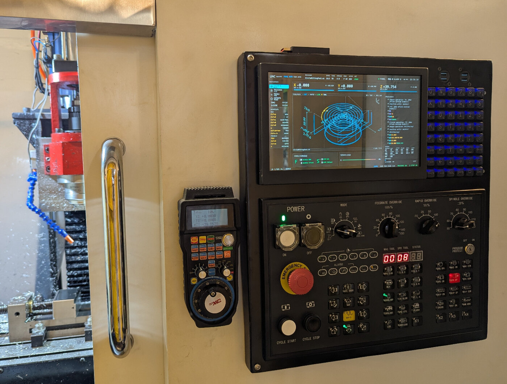

*LiNC on the mill it is written for: the screen in the panel, the panel's keys
and dials in reach of both hands, and the handwheel pendant on the wall.*

## Documentation

- **[Operator manual (PDF, 75 pages)](doc/manual.pdf)** — the machine from the
  operator's side: the panel, the keyboard, the modes, running and editing
  programs, MDI, tools and offsets, probing, diagnostics, and a quick reference.
- The sources are in [`doc/`](doc/); `make` in that directory rebuilds the PDF
  with `pdflatex` (two passes).
- The design reasoning is in [`SPEC.md`](SPEC.md), the profile format in
  [`CONFIGURATION.md`](CONFIGURATION.md).

## What makes it different

**The panel is the control surface, and LiNC respects that.** There is no
software E-stop, no software jog button, no feed override slider and no mode
switch on screen. Those belong to the panel, so a second copy on a touch screen
cannot drift out of agreement with the hardware. Where the software must send a
machine command — a tool change, an MDI block, a probing cycle — it says so
explicitly instead of pretending to be a jog button.

**MDI is a working area, not a text box.** The MDI pane keeps a list of the
blocks you have issued, holds focus in the input, and draws the block you are
typing on the machine's toolpath before you send it. The preview understands
`G91`, so a relative move is drawn where it will go. If the block would
leave the machine's travel envelope, the frame turns red and the limit is named
in the result line: the block is refused rather than sent and clipped.

**The toolpath tells you what the machine will do.** The loaded program is drawn
in program colours, and the part of it that runs outside the machine's travel
limits is drawn solid red. The live trail is a separate green line, so "where the
tool has been" and "what the program says" never get mixed up. While the head
moves, the view follows it; when the head is still, the view stays where you put
it, so you can zoom into another part of the program without being pulled back.

**Touch probing is a guided workflow.** Choose a category, pick an illustrated
operation, adjust clearance, feed and tip values, then run it. The probing math
is not reinvented: the Probe Basic G-code routines are shipped with LiNC and
called as they are, and the results come back into the screen.

**Tool changes do not need MDI.** Select a row in the tool table and press
change; LiNC issues the tool change for you, and the manual case asks you to
install the tool and confirm it.

**The editor checks work before the machine sees it.** The Program page doubles
as a G-code editor with syntax highlighting, undo and redo, unsaved-change
state and a live preview. An edit updates the drawing only after it parses, and
saving is refused while a program runs or the machine is in program protect.

**G-code help is on the machine, offline.** A searchable reference for LinuxCNC
G-codes, M-codes, parameters and units, with per-code detail pages. It works
with no network and stays readable while a program runs.

**The network can be taken away from the machine while it cuts.** On a machine
whose only network link is WiFi, LiNC can hold that link down whenever a program
is loaded or MDI is selected, and hand it back when you unload. This keeps WiFi
latency and driver interrupt storms out of the realtime path. The `NET` field in
the top bar always says what the link is doing, and `Ctrl+U` on the Program page
unloads the program and gives the link back. Machines without this configured
behave exactly as before, with the interlock switched off.

**One shell for a mill and a lathe.** Axis count comes from the LinuxCNC INI
file, so a 3-axis mill, a 4-axis mill and an X/Z lathe with live tooling and a
turret are the same program with different profiles.

**It is a keyboard machine.** LiNC is designed for a QMK keyboard with labelled
keys: `MAIN`, `FILE`, `TOOL`, `OFFSET`, arrows, `Enter`, `Esc`. There are no
F-softkeys to memorise, and every on-screen action can also be reached with the
arrow keys and `Enter`.

## Status and verification

The workspace implements the specification in simulation. LiNC is already
running on the author's physical mill, in trial use: the mill profile runs end
to end on the machine it was written for, and the lathe profile validates and
runs with `configs/lathe-sim.ini`. The screens implemented are Machine, Program
(both `SPLIT` and `CODE` layouts), Offsets, Tools, Diagnostics, G-code Help,
Files, Touch Probe, Manual and Homing; MDI is a pane on the Machine page.

`cargo test --workspace` covers profile merging, INI parsing, command validation,
the editor and preview behaviour, graph bounds, the panel protocol, the HAL
output allowlist and the simulator backend.

The items that still need a real machine or a commissioned LinuxCNC session are
listed in
[`CONFIGURATION.md`](CONFIGURATION.md#12-remaining-hardware-verification).

`linc-mcp` exposes the HMI and panel diagnostic sockets to an agent — state,
gates, logs, events, panel frames, motion history, crash records, a screen model
and a diagnostic bundle — with an opt-in simulator control surface. It never
opens the panel's serial port.

## ⚠️ Safety and Liability Disclaimer

**Read this before you use LiNC on a machine.** The full notice is also printed
at the front of the [operator manual](doc/manual.pdf).

LiNC controls CNC machines and other potentially dangerous equipment. By using
it you acknowledge and agree to the following.

### No warranty

THIS SOFTWARE IS PROVIDED "AS IS", WITHOUT WARRANTY OF ANY KIND, EXPRESS OR
IMPLIED, INCLUDING THE WARRANTIES OF MERCHANTABILITY, FITNESS FOR A PARTICULAR
PURPOSE AND NON-INFRINGEMENT. THE SOFTWARE MAY CONTAIN BUGS, ERRORS OR DEFECTS
THAT COULD CAUSE EQUIPMENT MALFUNCTION, PROPERTY DAMAGE, PERSONAL INJURY OR
DEATH.

### No liability

IN NO EVENT SHALL THE AUTHORS, COPYRIGHT HOLDERS OR CONTRIBUTORS BE LIABLE FOR
ANY CLAIM, DAMAGES OR OTHER LIABILITY, WHETHER IN AN ACTION OF CONTRACT, TORT OR
OTHERWISE, ARISING FROM, OUT OF OR IN CONNECTION WITH THE SOFTWARE OR THE USE OF
THE SOFTWARE, INCLUDING BUT NOT LIMITED TO:

- personal injury or loss of life;
- damage to the machine, tooling, workpiece or other property;
- loss of data or work product;
- loss of business or profits;
- any direct, indirect, incidental, special, exemplary or consequential damage.

### Your responsibility

YOU ARE SOLELY RESPONSIBLE FOR:

1. **Safety measures** — the emergency stop, guards, interlocks and protective
   equipment required by the applicable safety standards.
2. **Testing and validation** — proving a program in a safe place before it runs
   on production equipment.
3. **Supervision** — never leaving a CNC machine running unattended.
4. **Compliance** — the laws, regulations and standards that apply where the
   machine is installed.
5. **Professional review** — having the installation reviewed by qualified
   engineers or safety professionals before it is used in a critical
   application.
6. **Risk assessment** — understanding the risks of the machine and taking the
   precautions they require.
7. **Maintenance** — keeping the machine and its safety devices in safe working
   order.

### CNC-specific warnings

A CNC machine moves rapidly and with great force. It can crush and trap, it
throws broken tools and workpiece fragments, a spindle can start a fire, its
electrical installation is hazardous, and cutting produces noise and dust.

**Do not operate CNC equipment unless you are trained and qualified to do so.**

### Hardware, not software

The emergency stop, the guards, the door interlocks, the limit switches and the
machine's own safety circuits are hardware. They must stay functional and
independent of this software, and they must never be bypassed. LiNC cannot see
everything the machine does, cannot prevent every programming error, and its
interlocks (including the network interlock) are convenience features, not
safety functions.

### No support guarantee

LiNC is provided on a voluntary basis. The authors are under no obligation to
provide support, updates, bug fixes or any assistance.

### Assumption of risk

BY USING THIS SOFTWARE YOU EXPRESSLY ACKNOWLEDGE AND ASSUME ALL RISKS ASSOCIATED
WITH ITS USE. If you do not agree to these terms, do not use the software.

### Effect, acceptance and limits

The first start shows this notice and asks for acceptance. The answer is
recorded, with the version of the notice, in the profile's preferences file;
`linc --accept-safety-notice` records the same acceptance without the dialog,
for provisioning and kiosks. When the notice changes, its version changes with
it and the dialog asks once more.

Nothing here excludes or limits liability that cannot be excluded or limited by
applicable law: liability for intent, for gross negligence, for injury to life,
body or health, and liability under mandatory product liability law remain
unaffected.

The licence is GPL-2.0-or-later: the text is in [`LICENSE`](LICENSE), declared
in `Cargo.toml` and recorded in `debian/copyright`. This notice is not legal
advice; have the terms reviewed before a commercial or safety-relevant
deployment.

## Rules the software keeps

These are not preferences; they are the behaviours the screens are built
around, and each one exists to keep the software and the machine in agreement.

- **No software machine controls.** No jog, no cycle start, no override slider,
  no software E-stop. The panel owns them. The exceptions are explicit commands
  the operator asks for by name: an MDI block, a tool change, a probe cycle.
- **Program protect is a lock.** While the panel's protect switch is on, LiNC
  cannot save G-code, write offsets or the tool table, import files or apply
  probe results. Unsaved edits are kept, read-only, instead of being thrown
  away. If the switch state is unknown or stale, the software assumes it is on.
- **Homing belongs to the panel.** HOME mode shows what each axis is doing, and
  the panel's rapid and axis keys do the homing. PROG.HOME sends the
  `G0 X0 Y0 Z0` style move that LinuxCNC already defines; the HMI does not
  intercept either.
- **Red means outside the machine.** Any part of the loaded path outside the
  travel envelope from the INI file is drawn solid red, and an MDI block that
  would leave it is refused before it is sent.

## Screenshots

These are captures of the current build in the simulator, at 1600×1000, with the
demonstration part loaded. Click any image to open the full-size PNG.

| **CNC control panel** (separate window) | **MDI** |
|:---:|:---:|
| [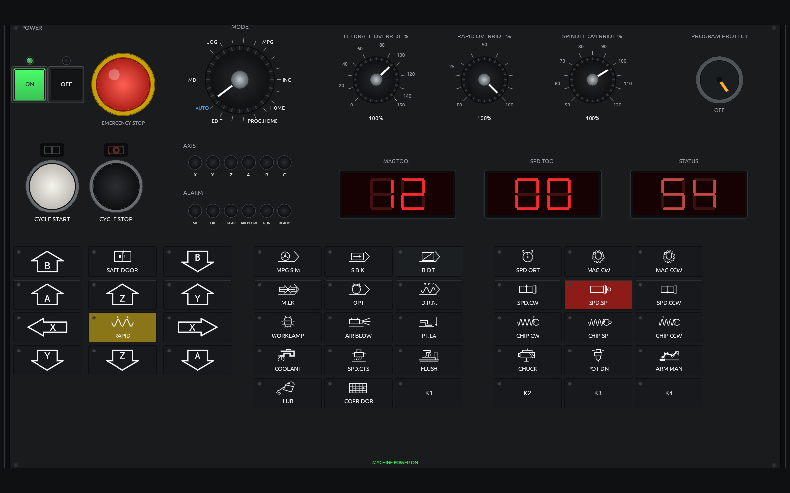](docs/screenshots/panel.png) | [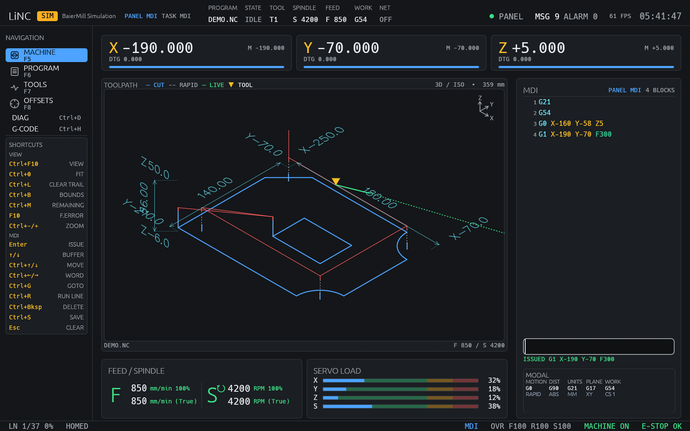](docs/screenshots/mdi.png) |
| **Machine** | **Program** |
| [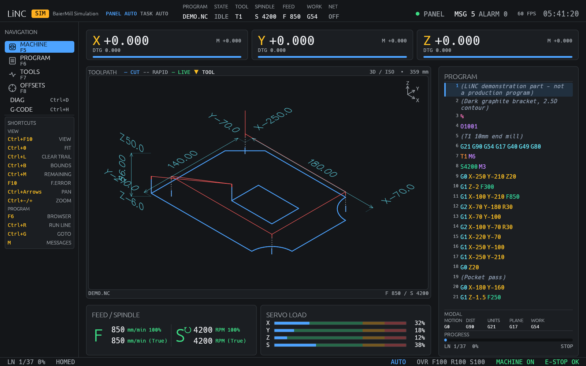](docs/screenshots/machine.png) | [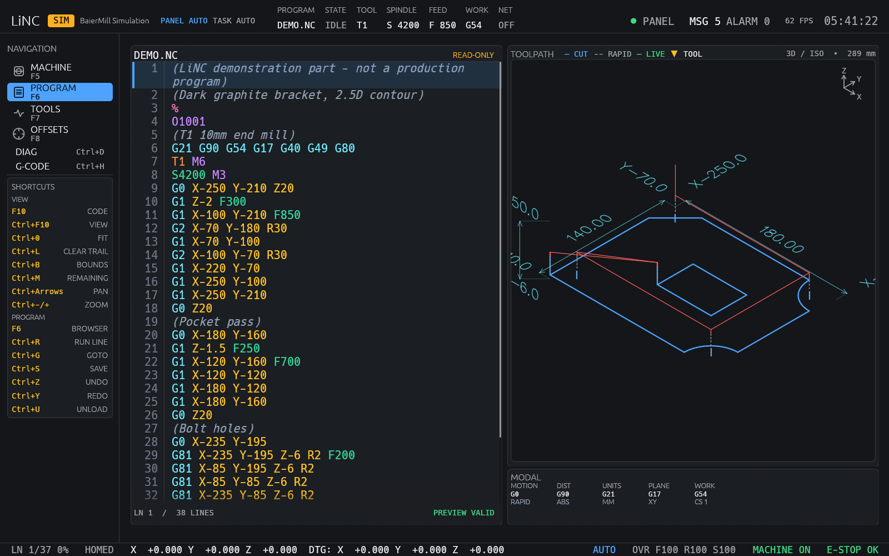](docs/screenshots/program.png) |
| **Tools** | **Offsets** |
| [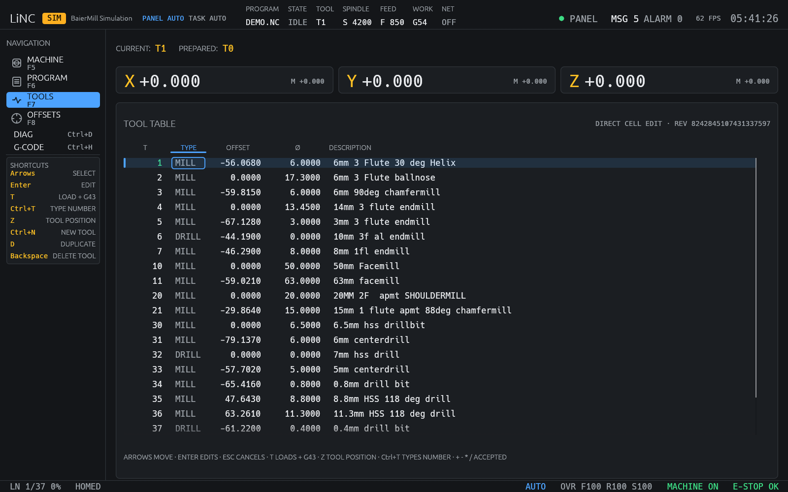](docs/screenshots/tools.png) | [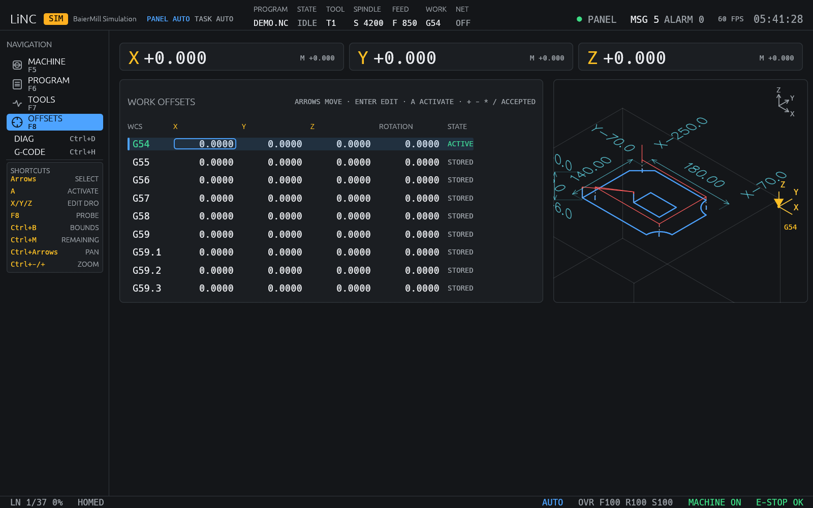](docs/screenshots/offsets.png) |
| **Diagnostics** | **G-code help** |
| [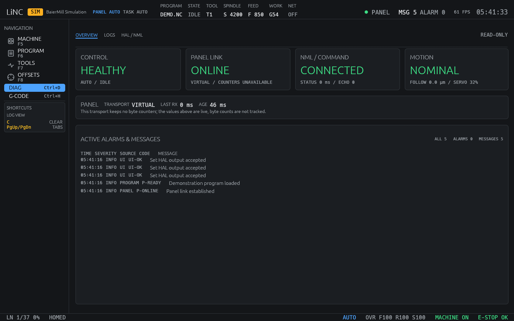](docs/screenshots/diagnostics.png) | [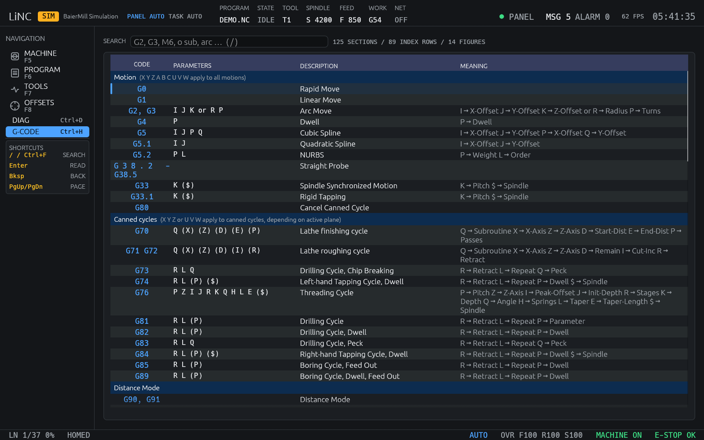](docs/screenshots/help.png) |
| **Touch probe** | **Files** |
| [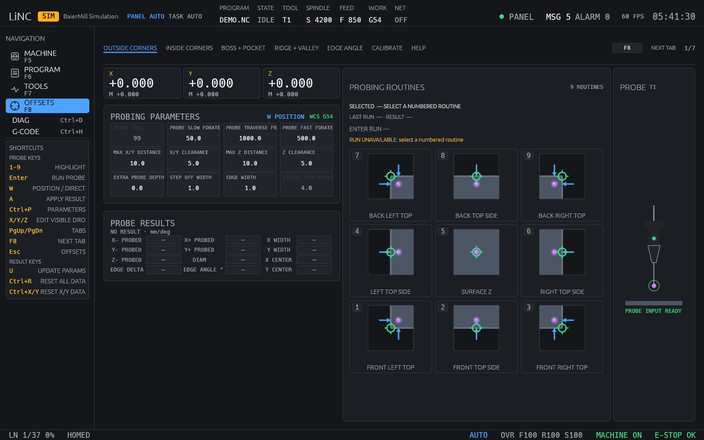](docs/screenshots/probe.png) | [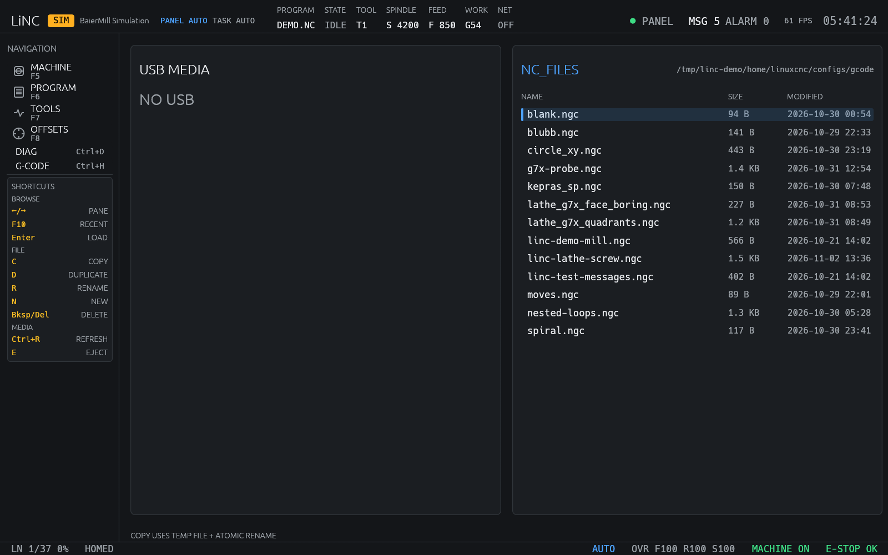](docs/screenshots/files.png) |

## Try it

The simulator needs LinuxCNC's development files and a C++ compiler, because the
native backend is linked even when the simulator is selected.

```sh
cargo build --release
./scripts/start-sim.sh          # foreground; Ctrl+C stops the session
./scripts/start-sim.sh --detach # background
./scripts/stop-sim.sh
```

A session starts the way a real cabinet is found: emergency stop latched and
power off. Ask for the rest in steps:

```sh
# released E-stop, powered on, homed, demo part loaded, window floated
./scripts/start-sim.sh --detach --release-estop --power-on --home --load --float

# lathe simulation: same lifecycle and flags, its own profile and INI
./scripts/start-lathe-sim.sh --detach --release-estop --power-on --home
```

Each flag implies the step before it, because the mushroom and POWER ON belong
to the panel and the software must not press them behind its back. If a step
does not happen, `scripts/sim-ready.py` prints the HAL pins holding it.

To check a profile without opening a window or touching HAL:

```sh
linc --config configs/sim.toml --check-config
```

## Demo AppImage

`scripts/build-appimage.sh` builds a self-contained demo for a desktop with no
LinuxCNC, no HAL and no panel. It starts the HMI and the simulated panel as two
windows and uses the built-in simulator and demo program.

```sh
scripts/build-appimage.sh
./target/appimage/LiNC-0.1.0-x86_64.AppImage
```

The HMI is built here without the native NML client, so the archive needs only
glibc. With `zig` installed the script links against glibc 2.36; `--native` uses
the host toolchain instead. This build is a demonstration: it does not connect to
a machine, a real LinuxCNC session or the panel's serial link.

## Installing on a machine

LiNC is configured per machine, and the profile is chosen explicitly — nothing
is discovered by looking around the filesystem.

| Profile | File |
|---|---|
| Shared defaults | `configs/base.toml` |
| Mill simulation | `configs/sim.toml` |
| Physical machine | the machine's own profile, next to its LinuxCNC INI |
| Lathe simulation | `configs/lathe-sim.toml` |

The profile points at the LinuxCNC INI file, which stays authoritative for
travel, velocities, units, spindle and ATC data and the tool table. LiNC reads
the INI; it does not replace it.

Two HAL files wire LiNC into LinuxCNC:

```ini
[HAL]
HALFILE = /path/to/LiNC/hal/linc.hal
POSTGUI_HALFILE = /path/to/LiNC/hal/linc-postgui.hal
```

`LINC_CONFIG` must name the same profile that the `linc` display uses:

```sh
export LINC_CONFIG=/path/to/LiNC/configs/machine.toml
linc --config "$LINC_CONFIG"
```

The HMI writes only the HAL outputs it declares: `linc.hmi-alive`,
`linc.tool-change-confirm`, `linc.status-display`, `linc.jog-increment`,
`linc.jog-speed`, `linc.machine-off` and `linc.net-safe`. There is no API for
writing an arbitrary pin.

The machine's LinuxCNC HAL must provide the `cnc_panel` component that
`hal/linc.hal` expects, or alias its own panel component to that name.

## Configuration

`CONFIGURATION.md` documents the profile format, the merge rules (`extends`
resolves the whole chain), the safety policy and the launch integration. The
short version:

- `[ui] scale` multiplies the 1280×720 design size. `"auto"` and `"1.0"` are the
  design size; `"0.8"`, `"80%"` and `"1.25x"` force a factor between 0.5 and 3.0.
  The shell scales from the physical viewport, so desktop HiDPI settings do not
  shrink the text. The window never goes below 1280×720.
- `[network]` is optional. It names one external interface — the WiFi radio or a
  second network card, never the machine's fieldbus — and holds it down while
  the machine can move. The section is off unless a profile enables it.
- `[loobric]` is optional. It syncs the tool table with a Loobric server using
  the official Python client, waits for an idle machine and reports its result
  on the Tools page. See [`docs/loobric.md`](docs/loobric.md).

## Testing probes without a machine

`crates/linc-sim3d` models the machine body, the probe and the cutters, loads
STEP workpieces and publishes probe contact on its own HAL component. Cutting
material is not simulated.

```sh
./target/debug/linc-sim3d --config configs/sim3d.toml   # window, jogged from the panel
./target/debug/linc-sim3d --hal                         # HAL component and window
./target/debug/linc-sim3d --selftest                    # probe sweep, PASS/FAIL lines
```

`scripts/start-sim.sh --sim3d` starts the HAL mode, where one process owns the
HAL component and the view. The details — pins, probe wiring, coordinates,
workpiece formats and limits — are in [`docs/sim3d.md`](docs/sim3d.md).

## How it is put together

The HMI runs behind a typed `MachineBackend` interface, with the LinuxCNC
implementation reading and writing NML directly. `linuxcnc-nml` owns the status,
command and error channels; a read-only HAL reader handles panel and spindle
pins. [`docs/architecture.md`](docs/architecture.md) describes the implemented
path, the Python helper that was removed, and the alternatives that were
rejected. [`docs/architecture.html`](docs/architecture.html) is the same walk
through with diagrams.

The panel is a LiNC-owned process, not part of the HMI. It decodes steady
one-hot modes and overrides, hides the panel technology behind a driver
interface, and is the only process that opens the serial port. When a machine
has no panel, the same process draws the panel in its own window and publishes
the same pins, so the HMI and HAL cannot tell the difference.

The 3D view and the toolpath renderer in `crates/linc-view` are used by every
page that draws a path, so the program, the live trail, the tool marker and the
work-zero cross move together under pan, zoom and orbit.

## Repository layout

```text
LiNC/
├── Cargo.toml
├── README.md
├── CONFIGURATION.md
├── SPEC.md
├── configs/              # profiles, demo INI files, tool tables, G-code
├── subroutines/
│   └── probe_basic/      # Probe Basic probing G-code, vendored verbatim
├── docs/                 # architecture, diagrams, README screenshots
├── crates/
│   ├── linc-app/         # command line, backend selection, window, event loop
│   ├── linc-core/        # config, INI, model, commands, HAL, simulator, network
│   ├── linc-hal/         # typed linc.* HAL output component
│   ├── linc-linuxcnc/    # native LinuxCNC NML backend
│   ├── linc-panel/       # RS-485 panel service and simulated panel
│   ├── linc-ui/          # egui shell, pages, keyboard model
│   └── linc-view/        # toolpath and lathe graph rendering
├── hal/                  # linc.hal, linc-postgui.hal
├── scripts/              # start-sim.sh, start-lathe-sim.sh, stop-sim.sh, ...
├── tools/                # G-code help generator
└── svg/                  # accepted mockups for every screen
```

## Probe Basic routines

The probe screen does not reimplement the probing math. `subroutines/probe_basic/`
holds the upstream `.ngc` routines as they are, with their license, the upstream
commit and checksums. A profile whose INI does not put that directory first in
`SUBROUTINE_PATH` cannot run a probe cycle, and `--check-config` says so before
the machine tries. `configs/sim.ini` also sets
`ON_ABORT_COMMAND = O<on_abort> CALL`, so an aborted probe restores feed override
instead of leaving it cancelled; whether the machine does the same is the machine
owner's decision.

LiNC is GPL-2.0-or-later, which is compatible with shipping the Probe Basic
routines under GPLv3 next to it. The directory keeps its own `LICENSE`,
`SOURCE.md` and `SHA256SUMS`.

## License

GPL-2.0-or-later. The full text is in [`LICENSE`](LICENSE); `Cargo.toml` declares
it and `debian/copyright` records the packaging details, including the GPLv3 text that the vendored Probe Basic
routines carry. The warranty and liability disclaimer that applies to using the
software is in [Safety and Liability Disclaimer](#%EF%B8%8F-safety-and-liability-disclaimer).
