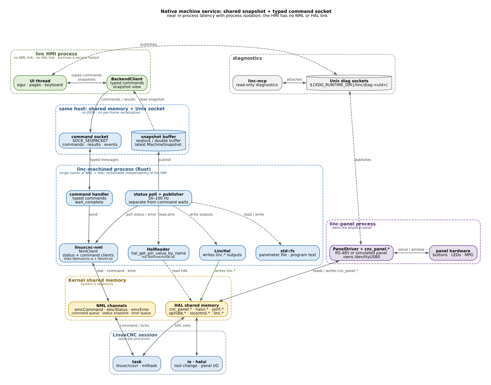
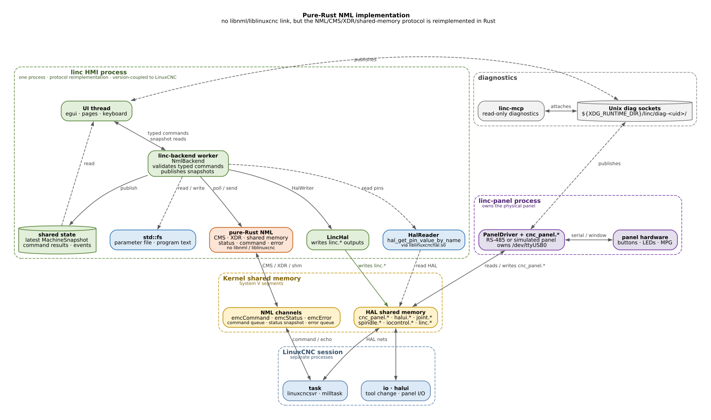
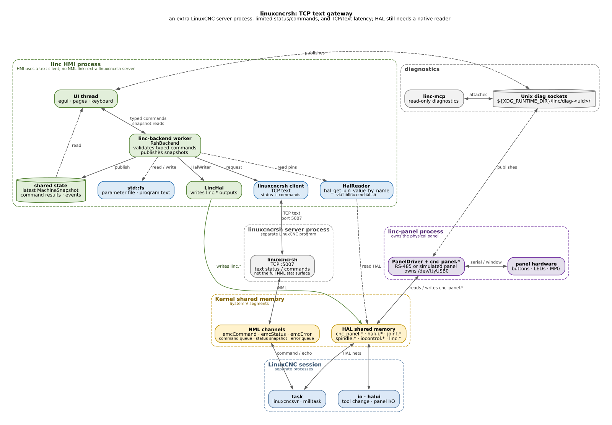
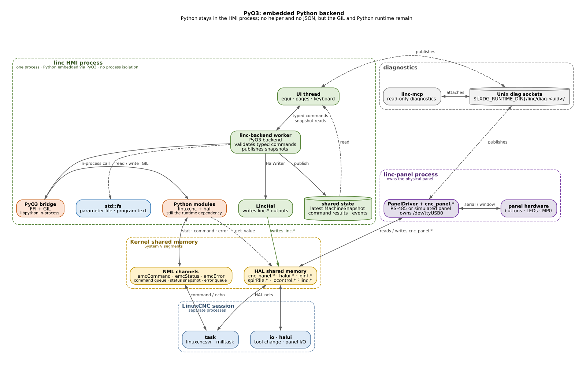

# LiNC + LinuxCNC architecture

These diagrams show the **LinuxCNC backend path** only. Simulator mode
(`--sim`) replaces the whole NML/helper column with `SimBackend` and the
`LINC_SIM_IPC` files; the panel service, HAL outputs, UI, and diagnostics stay
the same.

**Colours:** green = `linc` HMI, blue = native helper/service paths, orange =
Python or a high-risk reimplementation, yellow = kernel shared memory, purple =
panel service, grey = diagnostics or an auxiliary server.

## Current: supervised Python helper


The HMI is one process with several threads. The `linc-backend` worker owns the
`MachineBackend`, validates typed commands, and publishes snapshots. A second
thread (`read_loop`) parses the helper's JSON snapshots and converts them to
`MachineSnapshot`.

A separate `python3` process runs [`linc_bridge.py`](../crates/linc-linuxcnc/python/linc_bridge.py).
It uses the official `linuxcnc` and `hal` Python modules to read `emcStatus`,
send `emcCommand` messages, drain `emcError`, and read panel/spindle HAL pins.
That process is the runtime Python dependency.

The panel service is deliberately separate: it owns `/dev/ttyUSB0` and the
`cnc_panel.*` HAL surface, so a UI crash cannot remove panel control. The HMI
only writes the five typed `linc.*` outputs through `LincHal`.

## NML-based: supervised Rust helper


The recommended first step replaces the `python3` child with
`linc-nml-bridge`, a Rust process that speaks the same newline-delimited JSON
protocol. The HMI-side supervisor, `read_loop`/`Converter`, validation, UI,
panel service, HAL outputs, and diagnostics are unchanged.

Inside the helper:

- [`linuxcnc-nml`](../../linuxcnc-nml/README.md) owns `NmlClient` and talks
  to the same `emcCommand`, `emcStatus`, and `emcError` channels as the Python
  module. It links `liblinuxcnc.a` and `libnml.so`.
- A read-only `HalReader` uses `hal_get_pin_value_by_name` from
  `liblinuxcnchal.so` for panel, spindle, pendant, and `iocontrol` pins. It
  creates no HAL pins and never opens a serial device.
- Ordinary `std::fs` handles the parameter file (`G54`–`G59.3`, `G92`, probe
  parameters) and program text.

The process boundary stays for the same reason the panel service has one: a
helper crash leaves the HMI alive to show `NML-LOST` and keep the panel service
running, and a LinuxCNC restart is reported as a lost status link instead of
taking the UI down. In-process NML is possible later, but it loses that
isolation.

## Does the JSON hop matter?

Not much. A representative 2.9 KB snapshot (without program text) takes about
37 µs to serialize with `json.dumps` and 37 µs to parse with `json.loads` on
this machine. A JSON line round-trip through a child process is about 22 µs
median (43 µs at p99) in a local echo test. The status loop is capped at
`status_hz = 20` (50 ms), and the simulator's task cycle averages about 10 ms,
so the JSON/process hop is well under 1 ms and under 2% of the status period.
A large program is sent only when the file changes, so it is a one-off copy,
not steady-state cost.

The bridge is also not in the jog, cycle, spindle, or feed path. Those are
panel → HAL → `halui`/motion. The bridge handles MDI, offsets, tool changes,
program load, and probing, which are supervisory operations.

The latency that does matter is the helper's single-threaded loop. A mode
switch waits for `wait_complete` (2 s in `issue`, 5 s request timeout), and the
Python loop emits no snapshots while it waits. A Rust helper should handle
commands on a separate thread from the status poll; an in-process backend
should split status polling from command waits for the same reason. The NML
client is not thread-safe, so that means separate status and command clients,
or a mutex that is never held across `wait_complete`.

## Options

| Option | Data path | Added latency | Isolation | Build | Verdict |
|---|---|---|---|---|---|
| [Current Python helper](diagrams/current-architecture.png) | worker → JSON → `python3` → NML | JSON <1 ms; helper loop can block for seconds | Yes | Python runtime | Remove for the dependency, not latency |
| [Rust helper + JSON](diagrams/proposed-nml-architecture.png) | worker → JSON → Rust helper → NML | JSON <1 ms; process hop ~tens of µs | Yes | Helper links NML | Good migration step; keep if isolation is required |
| [In-process `NmlBackend`](diagrams/ideal-inprocess-architecture.png) | worker → `NmlClient` / `HalReader` | Direct calls; no IPC | No; `linc-panel` remains separate | HMI links NML | **Best latency and simplest end state for LiNC** |
| [Native machine service](diagrams/native-service-architecture.png) | worker → shared-memory snapshot + typed command socket | Near in-process | Yes | Service links NML | Ideal only if an NML crash must not take the HMI down; most work |
| [Pure-Rust NML](diagrams/pure-rust-nml-architecture.png) | worker → Rust NML | Similar to in-process | Depends | No libnml/liblinuxcnc; HAL still native | Not worth the protocol/version work |
| [`linuxcncrsh`](diagrams/linuxcncrsh-architecture.png) | TCP + text | Milliseconds and polling | Yes | Client simple; HAL still native | Too limited for status/commands |
| [PyO3](diagrams/pyo3-architecture.png) | worker → embedded Python | GIL + Python | No | Python dev files | Still Python; rejected |

## Ideal: in-process native backend


For LiNC, the ideal is an in-process `NmlBackend` on the existing
`linc-backend` worker: direct `NmlClient`, `HalReader`, and `std::fs` access,
with no helper, no JSON, and no Python. The UI, validation, panel service, HAL
outputs, and diagnostics stay as they are.

The panel service remains the important isolation boundary: it owns
`/dev/ttyUSB0` and `cnc_panel.*`, so an HMI crash still leaves the physical
panel able to control the machine. The tradeoff is that an NML/C++ shim crash
would take the HMI down with it.

If that tradeoff is unacceptable, the ideal becomes a native machine service
that owns NML and HAL and publishes a snapshot through shared memory, with
typed commands over a Unix socket. That preserves isolation and near-in-process
latency, but it is a much larger design than LiNC needs today.



## Other options

### Pure-Rust NML



The HMI implements the NML CMS/XDR/shared-memory protocol itself and links
neither `libnml` nor `liblinuxcnc`. HAL reads still go through
`liblinuxcnchal` (or require a second protocol implementation). The latency is
similar to the in-process native client, but the NML protocol and its structs
are version-coupled to LinuxCNC; this is a large maintenance burden for no
latency gain.

### `linuxcncrsh`



A `linuxcncrsh` client talks text over TCP to a separate server process. That
adds a server to configure and a text protocol to parse, and the server does not
expose the full NML status surface. HAL pins still need a native reader. It is
useful for diagnostics or simple remote commands, not for the HMI's full
status and offset/tool path.

### PyO3



PyO3 embeds Python in the HMI. It removes the separate helper and JSON, but it
keeps the Python runtime and the `linuxcnc`/`hal` modules, adds the GIL, and
gives no process isolation. It does not meet the "remove Python" goal.

## What changes, what stays

| Concern | Current Python helper | NML helper (migration) | In-process (ideal) |
|---|---|---|---|
| NML client | Python `linuxcnc` module | `NmlClient` in helper | `NmlClient` in HMI |
| HAL reads | Python `hal.get_value()` | `HalReader` in helper | `HalReader` in HMI |
| Helper process | `python3` + `linc_bridge.py` | `linc-nml-bridge` (Rust) | none |
| Transport | JSON lines | same JSON lines | direct calls |
| HMI supervisor | `PythonBridgeBackend` | `HelperBridgeBackend` | `NmlBackend` |
| Converter / UI / panel / diag | unchanged | unchanged | converter can be simplified |
| Crash isolation | helper crash keeps UI alive | same | HMI crash loses display; panel remains |
| Build dependency | Python runtime + `linuxcnc`/`hal` | helper links LinuxCNC NML | HMI links LinuxCNC NML |

## Migration note

During the switch, keep both helpers behind a flag (`--bridge python|nml`) and
run them against the same simulator. The `emcError` queue is single-consumer,
so run one helper at a time when comparing snapshots. Remove the Python helper,
`include_str!`, and the `python3` spawn in one final commit after the snapshot
and command parity checks pass. The helper must stay read-only on HAL and must
never open `/dev/ttyUSB0`; the panel service remains the only serial owner.

## Regenerating the diagrams

The sources are Graphviz files in `docs/diagrams/`:

```bash
cd docs/diagrams
dot -Tsvg current-architecture.dot -o current-architecture.svg
rsvg-convert -w 1600 current-architecture.svg -o current-architecture.png

dot -Tsvg proposed-nml-architecture.dot -o proposed-nml-architecture.svg
rsvg-convert -w 1600 proposed-nml-architecture.svg -o proposed-nml-architecture.png

dot -Tsvg ideal-inprocess-architecture.dot -o ideal-inprocess-architecture.svg
rsvg-convert -w 1600 ideal-inprocess-architecture.svg -o ideal-inprocess-architecture.png

dot -Tsvg native-service-architecture.dot -o native-service-architecture.svg
rsvg-convert -w 1600 native-service-architecture.svg -o native-service-architecture.png

dot -Tsvg pure-rust-nml-architecture.dot -o pure-rust-nml-architecture.svg
rsvg-convert -w 1600 pure-rust-nml-architecture.svg -o pure-rust-nml-architecture.png

dot -Tsvg linuxcncrsh-architecture.dot -o linuxcncrsh-architecture.svg
rsvg-convert -w 1600 linuxcncrsh-architecture.svg -o linuxcncrsh-architecture.png

dot -Tsvg pyo3-architecture.dot -o pyo3-architecture.svg
rsvg-convert -w 1600 pyo3-architecture.svg -o pyo3-architecture.png
```
