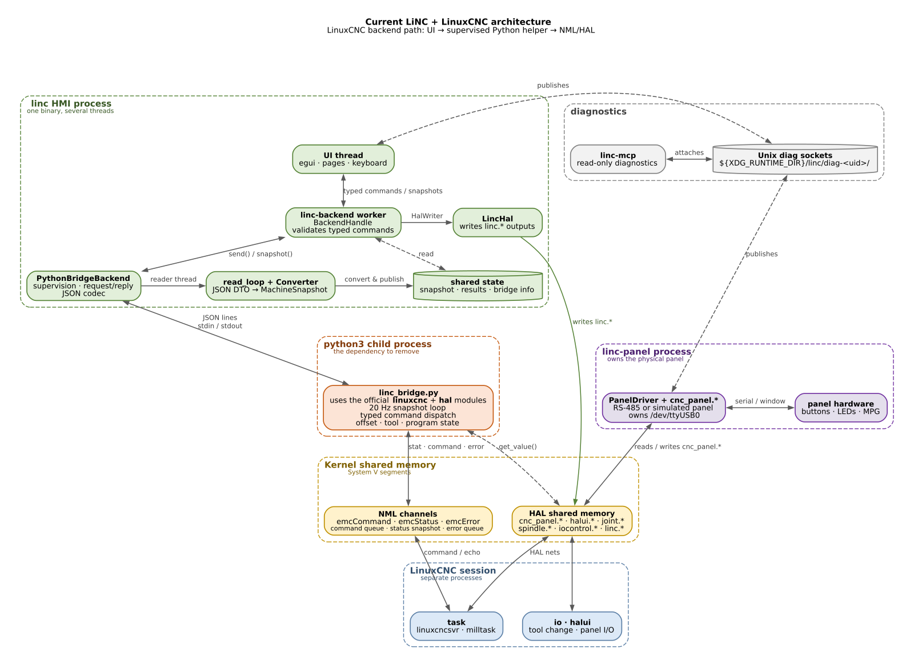
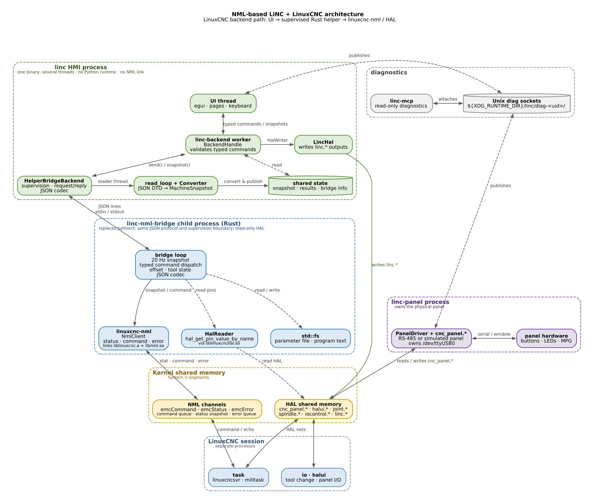

# LiNC + LinuxCNC architecture

These diagrams show the **LinuxCNC backend path** only. Simulator mode
(`--sim`) replaces the whole NML/helper column with `SimBackend` and the
`LINC_SIM_IPC` files; the panel service, HAL outputs, UI, and diagnostics stay
the same.

**Colours:** green = `linc` HMI, orange = current Python child, blue = proposed
Rust helper, yellow = kernel shared memory, purple = panel service, grey =
diagnostics.

## Current: supervised Python helper



The HMI is one process with several threads. The `linc-backend` worker owns the
`MachineBackend`, validates typed commands, and publishes snapshots. A second
thread (`read_loop`) parses the helper's JSON snapshots and converts them to
`MachineSnapshot`.

A separate `python3` process runs [`linc_bridge.py`](../crates/linc-linuxcnc/python/linc_bridge.py).
It uses the official `linuxcnc` and `hal` Python modules to read `emcStatus`,
send `emcCommand` messages, drain `emcError`, and read panel/spindle HAL pins.
That process is the runtime Python dependency.

The panel service is deliberately separate: it owns `/dev/ttyUSB0` and the
`cnc_panel.*` HAL surface, so a UI crash cannot remove panel control. The HMI
only writes the five typed `linc.*` outputs through `LincHal`.

## NML-based: supervised Rust helper



The recommended first step replaces the `python3` child with
`linc-nml-bridge`, a Rust process that speaks the same newline-delimited JSON
protocol. The HMI-side supervisor, `read_loop`/`Converter`, validation, UI,
panel service, HAL outputs, and diagnostics are unchanged.

Inside the helper:

- [`linuxcnc-nml`](../../linuxcnc-nml/README.md) owns `NmlClient` and talks
  to the same `emcCommand`, `emcStatus`, and `emcError` channels as the Python
  module. It links `liblinuxcnc.a` and `libnml.so`.
- A read-only `HalReader` uses `hal_get_pin_value_by_name` from
  `liblinuxcnchal.so` for panel, spindle, pendant, and `iocontrol` pins. It
  creates no HAL pins and never opens a serial device.
- Ordinary `std::fs` handles the parameter file (`G54`–`G59.3`, `G92`, probe
  parameters) and program text.

The process boundary stays for the same reason the panel service has one: a
helper crash leaves the HMI alive to show `NML-LOST` and keep the panel service
running, and a LinuxCNC restart is reported as a lost status link instead of
taking the UI down. In-process NML is possible later, but it loses that
isolation.

## What changes, what stays

| Concern | Current | NML-based |
|---|---|---|
| NML client | Python `linuxcnc` module | `linuxcnc-nml` / `NmlClient` |
| HAL reads | Python `hal.get_value()` | `HalReader` in the helper |
| Helper process | `python3` + `linc_bridge.py` | `linc-nml-bridge` (Rust) |
| Helper protocol | JSON lines over stdin/stdout | unchanged |
| HMI supervisor | `PythonBridgeBackend` | `HelperBridgeBackend` (same role) |
| Converter / UI / panel / diag | unchanged | unchanged |
| Crash isolation | helper crash keeps UI alive | unchanged |
| Build dependency | Python runtime + `linuxcnc`/`hal` modules | LinuxCNC headers and libraries |

## Migration note

During the switch, keep both helpers behind a flag (`--bridge python|nml`) and
run them against the same simulator. The `emcError` queue is single-consumer,
so run one helper at a time when comparing snapshots. Remove the Python helper,
`include_str!`, and the `python3` spawn in one final commit after the snapshot
and command parity checks pass. The helper must stay read-only on HAL and must
never open `/dev/ttyUSB0`; the panel service remains the only serial owner.

## Regenerating the diagrams

The sources are Graphviz files in `docs/diagrams/`:

```bash
cd docs/diagrams
dot -Tsvg current-architecture.dot -o current-architecture.svg
rsvg-convert -w 1600 current-architecture.svg -o current-architecture.png

dot -Tsvg proposed-nml-architecture.dot -o proposed-nml-architecture.svg
rsvg-convert -w 1600 proposed-nml-architecture.svg -o proposed-nml-architecture.png
```
