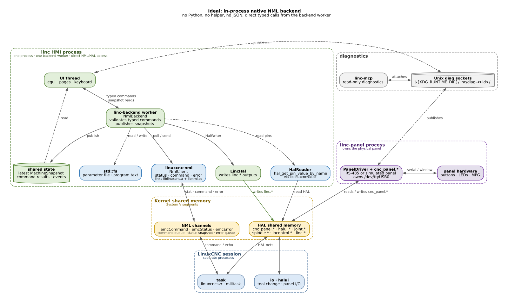

# LiNC + LinuxCNC architecture

For a visual tour of the current system, open the self-contained
[HTML architecture guide](architecture.html). It has the runtime map, command and
snapshot paths, HAL surface, failure domains and build requirements in one page.

These diagrams show the **LinuxCNC backend path** only. Simulator mode
(`--sim`) replaces the NML/HAL column with `SimBackend` and the `LINC_SIM_IPC`
files; the panel service, HAL outputs, UI, and diagnostics stay the same.

**Colours:** green = `linc` HMI, blue = native NML/HAL paths, orange = Python
or a high-risk reimplementation, yellow = kernel shared memory, purple = panel
service, grey = diagnostics or an auxiliary server.

## Current: in-process native backend



The `linc-backend` worker owns one [`NmlBackend`](../crates/linc-linuxcnc/src/lib.rs).
It is in the HMI process and has three collaborators:

- [`linuxcnc-nml`](../../linuxcnc-nml/README.md) owns `NmlClient` and talks to
  `emcStatus`, `emcCommand`, and `emcError` over the same NML channels AXIS and
  the official Python module use. It links `liblinuxcnc.a` and `libnml.so`
  through a small C++ shim.
- [`HalReader`](../crates/linc-hal/src/lib.rs) reads `cnc_panel.*`,
  `iocontrol.*`, `halui.*`, spindle feedback, and pendant pins through
  `hal_get_pin_value_by_name` from `liblinuxcnchal.so`. It creates a read-only
  HAL component with no pins, which is required before HAL has a `hal_data`
  pointer in the process. It has no write method.
- Ordinary `std::fs` handles the parameter file (`G54`–`G59.3`, `G92`, probe
  parameters) and program text.

The HMI still writes only the five declared `linc.*` outputs through
[`LincHal`](../crates/linc-hal/src/lib.rs). The panel service remains separate:
it owns `/dev/ttyUSB0` and the `cnc_panel.*` HAL surface, so an HMI crash does
not remove physical panel control.

### Implementation map

| Concern | Code |
|---|---|
| Status/command/error transport | `crates/linc-linuxcnc/src/lib.rs` |
| `Status` → `MachineSnapshot` | `crates/linc-linuxcnc/src/snapshot.rs` |
| Panel/spindle/pendant HAL reads | `crates/linc-linuxcnc/src/panel.rs` |
| Parameter-file row writes | `crates/linc-linuxcnc/src/parameters.rs` |
| HAL read-only FFI | `crates/linc-hal/src/lib.rs` |

### Build and runtime requirements

`linc-linuxcnc` links native LinuxCNC libraries. A build needs:

- the LinuxCNC development files (`/usr/include/linuxcnc`, `liblinuxcnc.a`,
  `libnml.so`, `liblinuxcncini.so`, `libtooldata.so`) and a C++ compiler;
- the sibling `../linuxcnc-nml` checkout, or an equivalent path in
  `crates/linc-linuxcnc/Cargo.toml`;
- a display running LinuxCNC at runtime. `--sim` does not link this path at
  runtime and uses `SimBackend` instead, but the binary still links NML.

A cross build needs target-side LinuxCNC libraries, not the host's. The current
`scripts/build-deb.sh` arm64 path therefore needs a target sysroot before it can
link the native NML client.

### Behavior notes

- `sync_work_offsets` handles the startup case where the interpreter restores
  the parameter file but only queues the G5X message. Once the machine is on and
  idle it re-initializes the interpreter, reads `g5x_offset` back, falls back to
  an MDI `G54`..`G59.3`, and retries a few times.
- Offset writes go through `G10 L2`/`G10 L20`; the controller computes the
  values. The backend mirrors the changed rows into the parameter file
  immediately, so a session killed before LinuxCNC exits does not lose them.
- The interpreter does not expose numbered parameters over NML. `#1001`–`#1009`
  are read from the parameter-file cache, exactly where LinuxCNC writes them;
  a probe result becomes visible on the next poll only after that file changes.
- `NmlClient` is one handle on the worker, because it is not thread-safe.
  `wait_complete` is used for mode switches and offset read-back. A long wait
  delays that worker's snapshots; splitting status and command clients is the
  next robustness step if command latency starts to matter.

### Crash isolation

The HMI is the failure domain for the native shim, just as it is for the UI.
The panel service survives an HMI crash, but the screen and NML link do not.
That tradeoff is acceptable for LiNC's single-seat HMI: the alternative is a
[native machine service](diagrams/native-service-architecture.png) that owns NML
and HAL, publishes a shared-memory snapshot, and accepts typed commands over a
Unix socket. It preserves isolation and near-in-process latency, but it is a
much larger design than the current HMI needs.

## Removed: supervised Python helper


The previous backend ran `python3` with an embedded `linc_bridge.py`, used the
official `linuxcnc` and `hal` modules, and exchanged newline-delimited JSON with
the HMI's `read_loop`/`Converter`. It worked, but it required a Python runtime
and added a process boundary and codec for no latency benefit.

The helper, its `include_str!`, the JSON DTOs, and the `python3` spawn are gone.
The old diagram is retained for comparison; it is not the current path.

## Options considered

| Option | Data path | Added latency | Isolation | Build | Verdict |
|---|---|---|---|---|---|
| [In-process `NmlBackend`](diagrams/ideal-inprocess-architecture.png) | worker → `NmlClient` / `HalReader` | Direct calls; no IPC | No; `linc-panel` remains separate | HMI links NML | **Implemented** |
| [Python helper](diagrams/current-architecture.png) | worker → JSON → `python3` → NML | JSON <1 ms; helper loop could block for seconds | Yes | Python runtime | Removed |
| [Rust helper + JSON](diagrams/proposed-nml-architecture.png) | worker → JSON → Rust helper → NML | JSON <1 ms; process hop ~tens of µs | Yes | Helper links NML | Rejected for LiNC; keep if isolation is mandatory |
| [Native machine service](diagrams/native-service-architecture.png) | worker → shared-memory snapshot + typed command socket | Near in-process | Yes | Service links NML | Only if an NML crash must not take the HMI down; most work |
| [Pure-Rust NML](diagrams/pure-rust-nml-architecture.png) | worker → Rust NML | Similar to in-process | Depends | No libnml/liblinuxcnc; HAL still native | Not worth the protocol/version work |
| [`linuxcncrsh`](diagrams/linuxcncrsh-architecture.png) | TCP + text | Milliseconds and polling | Yes | Client simple; HAL still native | Too limited for status/commands |
| [PyO3](diagrams/pyo3-architecture.png) | worker → embedded Python | GIL + Python | No | Python dev files | Still Python; rejected |

## What changed

| Concern | Previous Python helper | Current in-process |
|---|---|---|
| NML client | Python `linuxcnc` module | `NmlClient` in HMI |
| HAL reads | Python `hal.get_value()` | `HalReader` in HMI |
| Helper process | `python3` + `linc_bridge.py` | none |
| Transport | JSON lines | direct calls |
| HMI backend | `PythonBridgeBackend` | `NmlBackend` |
| Converter / UI / panel / diag | bridge DTO converter | `SnapshotBuilder` |
| Crash isolation | helper crash kept UI alive | HMI crash loses display; panel remains |
| Build dependency | Python runtime + `linuxcnc`/`hal` | LinuxCNC NML + `liblinuxcnchal` + sibling crate |

## Verification

The native backend was exercised against `configs/sim.ini` in an isolated IPC
namespace:

- NML status and HAL panel reads produced a valid snapshot (`power=On`,
  `panel=true`, `homed=true`);
- `SetWorkOffset { G54 }` reached the controller and the parameter file;
- `SetWorkPosition` (`G10 L20`) produced the expected work coordinate;
- `ZeroWorkOffset` reset it;
- `LoadProgram` opened `linc-demo-mill.ngc` and the snapshot showed 36 lines.

The HMI window itself could not be captured under this container's Xvfb because
the OpenGL context failed before the first frame; the backend and HAL paths above
run before window creation and were verified directly.

## Regenerating the diagrams

The sources are Graphviz files in `docs/diagrams/`:

```bash
cd docs/diagrams
dot -Tsvg current-architecture.dot -o current-architecture.svg
rsvg-convert -w 1600 current-architecture.svg -o current-architecture.png

dot -Tsvg proposed-nml-architecture.dot -o proposed-nml-architecture.svg
rsvg-convert -w 1600 proposed-nml-architecture.svg -o proposed-nml-architecture.png

dot -Tsvg ideal-inprocess-architecture.dot -o ideal-inprocess-architecture.svg
rsvg-convert -w 1600 ideal-inprocess-architecture.svg -o ideal-inprocess-architecture.png

dot -Tsvg native-service-architecture.dot -o native-service-architecture.svg
rsvg-convert -w 1600 native-service-architecture.svg -o native-service-architecture.png

dot -Tsvg pure-rust-nml-architecture.dot -o pure-rust-nml-architecture.svg
rsvg-convert -w 1600 pure-rust-nml-architecture.svg -o pure-rust-nml-architecture.png

dot -Tsvg linuxcncrsh-architecture.dot -o linuxcncrsh-architecture.svg
rsvg-convert -w 1600 linuxcncrsh-architecture.svg -o linuxcncrsh-architecture.png

dot -Tsvg pyo3-architecture.dot -o pyo3-architecture.svg
rsvg-convert -w 1600 pyo3-architecture.svg -o pyo3-architecture.png
```
