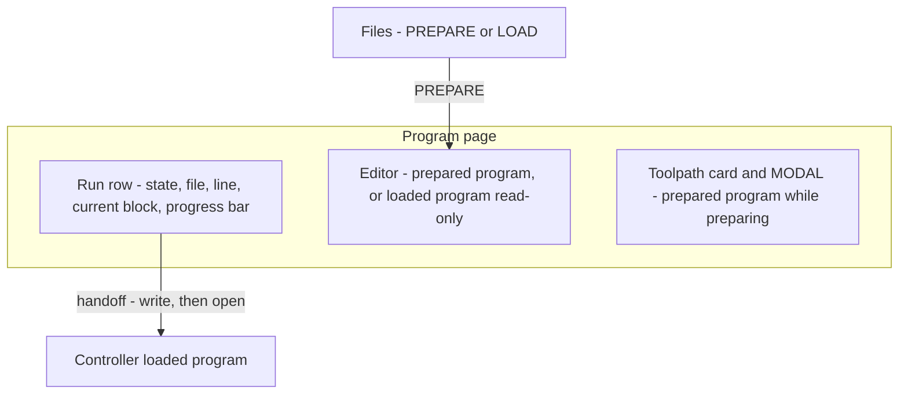
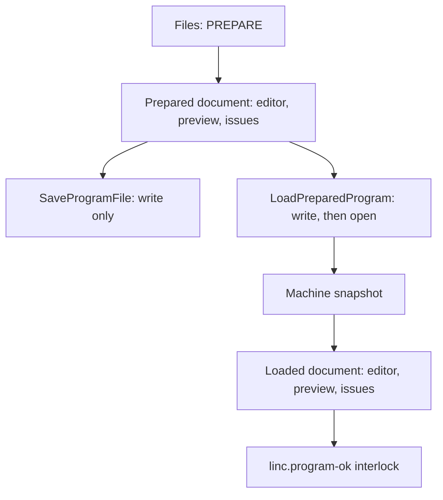
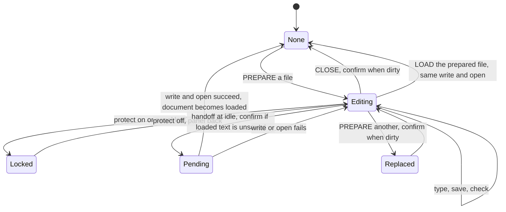
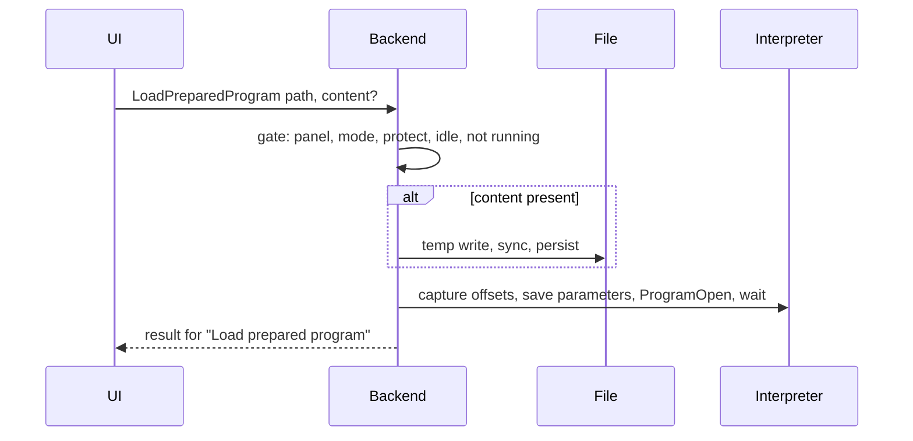

# Background program editing - Plan

## Goal Capsule

- **Objective:** A machine operator prepares, checks and saves the next program at the control while the current one cuts, then hands it to the controller at cycle end without leaving the machine or stopping the spindle to get there.
- **Means:** Two documents on the Program page sharing one document type, a PREPARE action beside LOAD in Files, and one backend verb that writes the prepared file and opens it (KTD1, KTD5, KTD2).
- **Authority:** This Product Contract governs behavior; the Planning Contract and the units decide mechanism. The panel keeps machine authority: nothing here starts, pauses or resets a program (SPEC.md §6.2, §11).
- **Execution profile:** One pull request. It lands with `cargo test --workspace` green and the simulator exercised by hand. Commits wait for explicit approval, per the repo's commit policy.
- **Stop conditions:** None. No `Resolve Before Planning` item remains; the two questions the Product Contract deferred resolve in KTD6 and KTD4, including the no-estimate case.

---

## Product Contract

### Summary

The Program page gains a second document: the loaded program stays in a pinned strip, and the editor below holds either that program, read-only while it runs, or a program being prepared for the next cycle. PREPARE is a separate verb from LOAD, so opening a file to edit it never disturbs the controller. At cycle end one press writes the prepared file and opens it as the loaded program.

### Problem Frame

A program change costs cutting time. Today the operator can prepare the next job in two ways: stop the run, put the panel in EDIT and edit at the machine, or walk to an external PC and edit there. The external editor was ruled out; it does not look or behave like a control, and the machine is not where that work happens. The external-PC route also splits the file's history between two places while the control holds the same-name program.

The cost is paid at every changeover, and it is bounded by the length of the program in front of the operator: a short run gives him minutes to prepare, a long one gives him hours, and today neither gives him anything to write into.

### Key Decisions

- KD1. **Two documents, one editor.** The page holds the controller's loaded program and at most one prepared program, and the editor shows one of them at a time. Governs R1, R4, R14, R21.
- KD2. **The run collapses into a strip above a full-width editor.** (session-settled: user-directed — chosen over side-by-side panes, a dedicated PREP screen, and a one-editor document switcher: it keeps the editor at its current width while the executing block, position and remaining time stay present.) Governs R2, R3, R10.
- KD3. **PREPARE is a separate verb from LOAD, in every machine state.** (session-settled: user-directed — chosen over PREPARE only while running: one meaning per action, rather than one whose effect changes with the machine state.) Governs R5, R6, R9.
- KD4. **Handoff writes then opens, in one press.** (session-settled: user-directed — chosen over requiring a clean buffer or a panel flip to EDIT first: cycle end happens in AUTO, and the mode flips would spend the time the feature exists to save.) Governs R15, R16, R17, R18.
- KD5. **The prepared file drives the graph, the MODAL pane, the fault list and the estimated time.** (session-settled: user-directed — chosen over keeping the running toolpath, or layering both: the operator is verifying the file he is preparing, and the strip carries the run.) Governs R10.
- KD6. **Protect, the panel link and the panel mode keep their authority.** Protect blocks edits, an unknown protect state counts as on, and the panel's EDIT position still governs the loaded program. Governs R12, R13, R20.
- KD7. **One prepared document, opened deliberately, with no queue.** Preparing a second program replaces the first, so the handoff has one unambiguous target. Governs R7, R15.
- KD8. **The handoff is the operator's press, never automatic.** (session-settled: user-directed — chosen over a prompt at cycle end, auto-loading, or a queue: nothing changes without the operator's press, and CYCLE START stays the panel's.) Governs R15, R16.

### Requirements

**Documents and the strip**

- R1. The Program page holds the controller's loaded program and at most one prepared program; the editor shows one of them at a time and changes document only when the operator prepares, closes or hands one off, never because a run starts or ends.
- R2. While a prepared program exists, a pinned run row above the editor names the loaded program: its state (idle, running or paused), its file, a rule, a progress bar on a fifth of what the rule leaves, its current line, a second rule, then the block it is executing; the block takes what is left and ends in an ellipsis when it does not fit. A run that reached its last command reads 100 %, even when the controller stops on an earlier line because the rest is blank. It says so plainly when no program is loaded. With nothing prepared there is no row.
- R3. While the loaded program is in front and runs or is paused, the editor shows it read-only and follows its current line, as it does today.
- R4. When no prepared program exists, the editor and graph behave as they do today with the strip still pinned above them: the editor holds the loaded program, and the panel's EDIT position makes it editable when the interpreter is idle.

**Preparing a program**

- R5. Files offers PREPARE and LOAD as separate actions in every machine state. PREPARE reads the selected file into the prepared document and never hands it to the controller; a read that fails leaves the prepared document unchanged and reports the reason. LOAD keeps today's meaning and stays refused while a program runs. LOAD of the prepared file is the handoff: the buffer is written, the file is opened, and no prepared document remains.
- R6. The loaded program cannot be prepared: selecting it for preparation is refused and the reason is stated.
- R7. One prepared document exists at a time. Preparing a second replaces the first only after the unsaved-changes confirmation, and cancelling keeps the first.
- R8. The prepared document has the editor's full behavior: cursor, selection, undo and redo, line operations, token highlighting, live syntax check and the fault walk.
- R9. Editing the prepared document needs no panel mode change and is available while a program runs, pauses or sits idle.
- R10. While the prepared document is in front, the toolpath card, the MODAL pane and the fault list describe the prepared file, the toolpath card also carries that file's estimated total time, and the live toolpath is not drawn.
- R11. Saving the prepared document replaces its file and leaves the controller's loaded program and its running text untouched.
- R12. PROTECT blocks typing and saving in the prepared document as it blocks edits to the loaded program, and an unknown or stale protect state counts as on; text and dirty state survive when the lock closes.
- R13. Saving the prepared document also needs a live panel link; when the link is missing the reason is named and the buffer is kept.
- R14. Closing the prepared document returns the editor to the loaded program and discards nothing without the unsaved-changes confirmation.

**Handoff**

- R15. When a prepared program exists, the editor header names it with `PREPARING:` before the filename, and the handoff is one press (`Ctrl+N` or the sidebar row) whenever the interpreter is idle, whatever the editor is showing.
- R16. The handoff action writes the prepared buffer, then opens that file as the loaded program. It never starts, resumes or pauses the machine, and it asks first when the loaded document still holds unsaved changes.
- R17. After a successful handoff the prepared document becomes the loaded program, the editor follows it, and no prepared document remains.
- R18. If the write or the open fails, the prepared buffer keeps its text and dirty state, the loaded program is unchanged, and a notice names the failure. While the write or open is pending, further presses are ignored.

**Preserved authority**

- R19. Nothing in the prepared surface can start, pause, resume, jog, change mode or write machine state, and the prepared document does not take Esc, which keeps resetting an active program.
- R20. The panel's EDIT position keeps its meaning for the loaded program, including the warning when EDIT is left with unsaved changes; saving the loaded program outside EDIT stays refused.
- R21. Leaving the Program page with a prepared buffer keeps it for the session, and quitting with one prompts the unsaved-changes confirmation.

### Key Flows

- F1. Prepare a program during a run
  - **Trigger:** The operator presses FILE while a program runs.
  - **Steps:** Files lists NC_FILES; the operator selects a file and picks PREPARE; the editor switches to the prepared document and its header names the file; the graph, MODAL pane, faults and estimated time follow it; the operator edits, checks and saves.
  - **Covers R5, R8, R9, R10, R11.**
  - **Outcome:** The file is written and the run is untouched.
- F2. Hand off at cycle end
  - **Trigger:** The loaded program stops and the interpreter goes idle while a prepared program exists.
  - **Steps:** the strip names the prepared program as ready; the operator picks the handoff action; the buffer is written, the file is opened as the loaded program, and the editor shows it; unsaved loaded text asks first.
  - **Covers R15, R16, R17.**
  - **Outcome:** The panel's CYCLE START runs the text the operator prepared.

### Acceptance Examples

- AE1. **Covers R1, R3, R9.** Given a program is running and no prepared program exists, when the operator presses FILE and PREPAREs another NC_FILES file, then the editor holds that file and is editable, the strip keeps naming the running program, and its line keeps moving.
- AE2. **Covers R6.** Given the loaded program is selected in Files, when the operator picks PREPARE, then the action is refused with a reason and the editor does not change.
- AE3. **Covers R7.** Given a dirty prepared buffer, when the operator PREPAREs another file, then a confirmation offers DISCARD or CANCEL; CANCEL keeps the first buffer and its dirty state.
- AE4. **Covers R12.** Given the operator is typing in the prepared document, when PROTECT turns on, then typing stops, the text and dirty marker stay, and SAVE reports the protect reason.
- AE5. **Covers R12, R13.** Given the panel link is offline, when the operator types in the prepared document, then typing is locked as it is for the loaded program, the buffer keeps its text, and SAVE names the missing link.
- AE6. **Covers R15, R16.** Given a run ends with a dirty prepared buffer, when the operator picks the handoff action, then the file is written, opened as the loaded program, the editor shows it, and the panel's CYCLE START runs the prepared text.
- AE7. **Covers R18.** Given the prepared file's directory is read-only, when the operator picks the handoff action, then the buffer keeps its text and dirty state, the loaded program is unchanged, and a notice names the failure.
- AE8. **Covers R19.** Given the prepared document has focus while a program runs, when the operator presses Esc, then the running program resets as it does today and the prepared buffer stays open.

### Success Criteria

- A changeover needs no program stop to prepare the next file: the operator can open, edit and save it while the spindle cuts.
- After the run ends, the handoff is one press plus the panel's CYCLE START.
- No action on the prepared surface can start, pause or resume a program, and the running text is never the file being written.
- The screen always names both files: the loaded program and, when one exists, the prepared program.

### Scope Boundaries

Deferred for later:

- A queue of prepared programs, or chaining runs.
- Automatic loading at cycle end; the handoff stays explicit.
- Importing from USB directly into the prepared document.
- Offset, tool-table or parameter edits while a program runs.

Outside this product's identity:

- Editing the program the controller is running.
- An on-screen cycle start.

### Dependencies / Assumptions

- The preview already carries per-file modal state, block timing, segments and faults, and a file the interpreter refused is already edited with its graph and faults drawn (`refuse_load` in `crates/linc-ui/src/shell/program.rs`). The prepared document reuses that path.
- LinuxCNC keeps the text it opened in the interpreter, so writing a different file cannot disturb a run. The prepared file is never the running file (R6).
- The simulator replaces its in-memory program on save instead of reopening a file, so the handoff must work through both backends.
- Writing a file while the panel is in AUTO is new for program files, though copying to USB and duplicate-to-USB already run during a program (`crates/linc-ui/src/screens/files.rs`). The write stays atomic, and protect still fails closed.
- `Ctrl+U` keeps meaning unload the controller's program, and Esc keeps meaning program reset while a program is active, so neither closes the prepared document.

### Outstanding Questions

- Deferred to Planning: which key or control closes the prepared document. Esc is taken by program reset and the panel keyboard has no Tab or Shift, so the binding must come from the keys the keymap already carries.
- Deferred to Planning: how the strip presents remaining time when the controller has no estimate for the run.

### Sources / Research

- `SPEC.md` §6.2 for the Program page, EDIT state, read-only-while-running rule and save/reopen behavior; §6.7 for Files; §7 for the palette and keyboard.
- `crates/linc-core/src/model.rs` (`program_editing_allowed`, `protect_effective`), `crates/linc-ui/src/shell/gates.rs` (`editing_allowed`, `save_block_reason`), `crates/linc-ui/src/shell/program.rs` (load, save, discard), `crates/linc-linuxcnc/src/lib.rs` (`validate_write`, `LoadProgram`, `SaveProgram` temp+rename+reopen), `crates/linc-core/src/sim.rs` (sim equivalents), `crates/linc-core/src/gcode.rs` (`Preview` modal, timing, issues), `crates/linc-ui/src/screens/files.rs` (load, duplicate and copy gates, copy-to-USB during a run).
- `docs/solutions/integration-issues/linuxcnc-save-must-reopen-program.md` for why a save must reopen the program.
- FANUC background edit, the industry pattern this mirrors and its known trap of an easy-to-enter, hard-to-leave mode: <https://www.cnctrainingcentre.com/using-fanuc-background-editing/>.
- Siemens 840D "Opening additional programs" for the same goal handled as extra editor windows (SINUMERIK 840D sl universal operating manual, §6.10.6).
- Heidenhain TNC 640 states a program cannot be edited while the control runs it, which is the restriction this feature deliberately lifts for a different file only.
- Layout sketch, machine-local and disposable: `tmp/ce-brainstorm-visual/bg-edit/screens/001-bg-edit-layouts.html`.
- Grounding dossier, untracked scratch in this worktree: `tmp/ce-brainstorm/program-bg-edit/grounding.md`.

## Planning Contract

**Product Contract preservation:** restructured, no scope change. The clarifications: R2 names the strip with nothing loaded; R4 stops claiming today's layout survives the strip; R5 gains the failed-read outcome and makes LOAD of the prepared file the handoff; R10 names the prepared file's estimated total time and leaves the run's countdown with the strip; R15 no longer needs a loaded program; R16 writes the buffer on every handoff and asks before superseding unsaved loaded text; R18 describes the pending state. The two questions the Product Contract deferred resolve in KTD6 (closing key) and KTD4 (remaining time while preparing, including when controller gives no estimate).

### Key Technical Decisions

KTD1. **Two document states, one type; the interlock stays bound to the loaded one.** `ProgramUi` keeps the page camera, layout and modal-independent state, and holds `loaded: Document`, `prepared: Option<Document>`, and which one is in front. Per-document fields move into `Document`: editor, preview, last valid preview, preview due, preview offsets and generation, issues, issue index, selection, cursor line, scroll target, path. `program_ready`, `sync_program`, `discard_editor_changes`, `machine_check`, `program_revision_seen`, `external_change`, `pending_load`, `request_load`'s dirty confirmation and `on_mode_change`'s leaving-EDIT warning read the loaded document only, because `linc.program-ok` is computed from that buffer and must never follow a file the controller does not run (`crates/linc-ui/src/shell/view.rs:192`). A LOAD with a dirty prepared buffer therefore prompts about nothing and discards nothing. Governs R1, R3, R4, R19, R20.

KTD2. **The handoff is one backend verb; the plain prepared save is another.** `SaveProgramFile { path, content }` writes atomically and changes nothing else, gated on a connected panel, a valid panel mode and protect known off; it refuses a write target that canonicalises onto the controller's loaded path. `LoadPreparedProgram { path, content }` always writes the buffer's text, then opens through the existing sequence, and adds idle and not-running to the gate; sending the text on every handoff means the version the operator checked is the version that opens, with no disk re-read in between. Both backends implement both arms. `SaveProgram` cannot be reused: it demands EDIT in both backends and reopens the interpreter, which a plain prepared save must not do and the handoff cannot do in AUTO (`crates/linc-core/src/command.rs:245`, `crates/linc-linuxcnc/src/lib.rs:1544`, `crates/linc-core/src/sim.rs:1421`). Keeping the write-then-open order inside one backend method follows `docs/solutions/integration-issues/linuxcnc-save-must-reopen-program.md`; the gate follows `mdi_save_block`, which is the save policy minus the mode condition. Governs R11, R12, R13, R15, R16, R17, R18.

KTD3. **Prepared text is editable whenever protect is known off and the panel link is up.** `prepared_editing_allowed` is `panel.connected && !protect_effective()`; idle, power and panel mode do not gate typing because typing moves nothing, and an unknown protect state counts as on, so a dropped link locks typing with saving. Governs R9, R12, R13.

KTD4. **Rendering follows the document in front; the run's remaining time follows the loaded one.** Preview refresh, issues, fault walk, selection and scroll target act on the front document. `common::trajectory` gains the live-layer switch needed to draw the prepared path without a trail or executing-line marker, and `common::modal_grid` takes the rows to draw, so the prepared document shows `Preview::modal` while the loaded one keeps the controller's modal. The toolpath card carries an estimate for the document it draws: the prepared file's total time while preparing, and the run's remaining time when the loaded program is in front. `tick_loops` and `tick_cycle_time` keep reading the loaded document, so the bottom bar's cycle and remaining fields and the run row's progress stay the run's while the prepared file is in front, and `preview_matches` means the loaded document is clean. Switching documents re-fits the graph the way `commit_load` does. Governs R2, R3, R8, R10.

KTD5. **PREPARE is a page action, not a backend command.** Files reads the selected NC_FILES file under the same extension and root rules as LOAD, refuses the controller's loaded path, and asks before replacing a dirty prepared buffer. The Files page must open while a program runs; `ShortcutCommand::OpenBrowser` refuses today, which would leave PREPARE unreachable. Governs R5, R6, R7, R14.

KTD6. **Keyboard and dialogs stay page-scoped and document-aware.** `Ctrl+S` saves the front document: prepared through `SaveProgramFile`, loaded through the existing path. `Ctrl+W` closes the prepared document and `Ctrl+N` runs the handoff, both added to `[keys]` as `prepared_close` and `prepared_handoff`, consumed before widgets draw and page-scoped like `Ctrl+U`; the handoff row is also focusable with arrows and run by Enter, and the handoff action is never a plain painted label. Neither key is Esc, which resets a running program. A dirty close asks, and the dialog names the prepared document through prepared-scoped `PendingAction` variants rather than reusing the load ones. Navigation guards keep asking about the loaded buffer only, quit asks about both, and the diagnostic socket keeps reporting the loaded document's dirty flag. Governs R14, R19, R21.

KTD7. **Backend confirmation drives the dirty flag, with a synchronous fallback.** The UI records a pending write or handoff and clears the prepared buffer's dirty state when the command is accepted; an error event for that command's label restores it and reports the reason. This follows `pending_load`, which drives `commit_load` from `BackendEvent::Command` by command label, so the new labels join that contract: "Save prepared program" and "Load prepared program". Governs R11, R16, R18.

KTD8. **No on-disk conflict check on a prepared save.** (session-settled: user-approved — proposed with the tradeoff visible: a save wins over a file another process changed after PREPARE; the operator's save is the newer intent.) Governs R11.

KTD9. **Documentation ships in the same change.** SPEC §6.2 gains the strip, the two-document rule, the prepared graph and MODAL source, and the new EDIT boundary; §6.7 gains PREPARE; §3.1 and §7 the new key; §8.2 the prepared gate; CONFIGURATION §10 the `prepared_close` key; AGENTS.md the page and keyboard notes. CODING_STANDARDS gains one rule only if the work establishes it; the candidate is that the program interlock never reads a document the controller does not run.

### High-Level Technical Design

The three views below carry the shape the units implement: what feeds the interlock, how a prepared document moves between states, and the order inside the handoff.

### Assumptions

- A prepared document is always a file chosen from NC_FILES; there is no untitled prepared buffer.
- Opening Files while a program runs changes nothing on the machine; the page's remaining verbs keep their current gates.
- One keymap entry is enough for the new close action, and the panel keyboard reaches it.

### Considered and Not Built

- Duplicate-while-running stays refused as it is today; PREPARE covers the copy only when the operator makes one first.
- A per-document graph camera: the camera stays on the page and re-fits when the document changes.

### Risks

- **Backend parity.** The simulator has hidden divergence before (`docs/solutions/integration-issues/hal-gate-needs-addf.md`); both backends must implement both commands, and a gate-policy test must run without a live controller.
- **Label matching.** Clearing the pending write depends on command label strings; changing a label silently stops the buffer from going clean. The labels join the same contract `Load program` already uses.
- **Interlock drift.** The split makes the interlock read the loaded document, but only if every accessor is used consistently; a future `program.editor` shim that follows the front document would reopen the hole.

## Implementation Units

### U1. Split per-document program state

- **Goal:** One `Document` type used twice, with the loaded document owning the program interlock and the snapshot sync.
- **Requirements:** R1, R3, R4, R19, R20.
- **Dependencies:** none.
- **Files:** `crates/linc-ui/src/state.rs`, `crates/linc-ui/src/shell/program.rs`, `crates/linc-ui/src/shell/sync.rs`, `crates/linc-ui/src/shell/view.rs`, `crates/linc-ui/src/shell/gates.rs`, `crates/linc-ui/src/shell/diag.rs`, `crates/linc-ui/src/shell/keyboard.rs`, `crates/linc-ui/src/shell/dialogs.rs`, `crates/linc-ui/src/screens/program.rs`, `crates/linc-ui/src/shell/ui_tests.rs`.
- **Approach:** Move the per-document fields into `Document`, add `doc()` and `doc_mut()` returning the front document and explicit `loaded()` / `loaded_mut()` where the interlock, snapshot sync and the dirty questions belong, and let the compiler walk the call sites. `request_load`'s confirmation and `on_mode_change`'s leaving-EDIT warning join the loaded-only set, so a LOAD with a dirty prepared buffer neither prompts nor discards. No other behavior change is intended in this unit.
- **Patterns to follow:** `MdiUi` keeps its own buffer, gate and save path beside the program editor; `FilesUi` keeps one focus flag over two panes.
- **Test scenarios:**
  - A revision change in the snapshot replaces the loaded document's text while a prepared document keeps its own text and selection (Covers R1, R3).
  - A prepared document with a syntax fault does not close the program interlock; the loaded document's clean text still does (Covers R19).
  - Undo on the front document leaves the other document's undo history untouched.
  - The existing shell tests for load, discard, save and mode changes pass unchanged.
- **Verification:** `cargo test --workspace` green; the Program page draws the loaded program in Split and Code as before.

### U2. Prepared document lifecycle and the Files PREPARE action

- **Goal:** The operator can open a second file for preparation, replace it, and close it, in any machine state.
- **Requirements:** R5, R6, R7, R9, R14, R21.
- **Dependencies:** U1.
- **Files:** `crates/linc-ui/src/screens/files.rs`, `crates/linc-ui/src/state.rs`, `crates/linc-ui/src/shell/program.rs`, `crates/linc-ui/src/shell/keyboard.rs`, `crates/linc-ui/src/shell/hints.rs`, `crates/linc-ui/src/shell/nav.rs`, `crates/linc-ui/src/shell/ui_tests.rs`.
- **Approach:** Add `ShortcutCommand::FilesPrepare` bound to `P` on the Files page, refused for the loaded path with the reason stated, and a hint row beside Enter. PREPARE reads the file through the same extension and root checks as load, sets the prepared document, refits the graph and leaves the controller alone. Add prepared-scoped pending actions for replacing and closing a dirty buffer, and open Files while a program runs by removing the `OpenBrowser` guard on the browse path while leaving load refused.
- **Patterns to follow:** `screens/files.rs` keys and hint rows; `PendingAction`/`ConfirmDiscard` for the dirty questions.
- **Test scenarios:**
  - With a program running, PREPARE on another NC_FILES file shows it in the editor, sends no `MachineCommand`, and the loaded program's line keeps following (Covers R5, R9).
  - PREPARE on the loaded program's own path is refused with a toast and leaves the editor unchanged (Covers R6).
  - A second PREPARE over a dirty prepared buffer asks; cancel keeps the first buffer's text and dirty marker (Covers R7).
  - Closing a dirty prepared buffer asks; discarding returns the editor to the loaded program; closing a clean one returns without a dialog (Covers R14).
  - Leaving the Program page with a prepared buffer open keeps it and shows no prompt (Covers R21).
  - PREPARE on a path that cannot be read reports the reason, leaves the current prepared document untouched and changes no dirty state (Covers R5).
  - A LOAD while the prepared buffer is dirty neither prompts nor discards the prepared text (Covers R21).
- **Verification:** In the standalone simulator, F6 opens Files while a program runs, P prepares, and the run is unaffected.

### U3. Front-document rendering: editor, graph, MODAL, faults, estimate

- **Goal:** Everything the page visualises describes the document in front, except the run's remaining time.
- **Requirements:** R2, R3, R8, R10.
- **Dependencies:** U1.
- **Files:** `crates/linc-ui/src/screens/program.rs`, `crates/linc-ui/src/screens/common.rs`, `crates/linc-ui/src/shell/view.rs`, `crates/linc-ui/src/shell/sync.rs`, `crates/linc-ui/src/shell/ui_tests.rs`.
- **Approach:** Route preview refresh and issues to the front document. Extract the graph's inputs into one helper so a test can prove the prepared path is drawn with the live layer off and without the executing-line marker. Pass the modal rows into `modal_grid` instead of reading the snapshot inside it. Keep the loop and cycle ticks on the loaded document.
- **Patterns to follow:** `commit_load`'s re-fit on a document change; `common::trajectory`'s existing flag set rather than a second draw path.
- **Test scenarios:**
  - With the prepared document in front, the graph inputs name its segments and carry the live layer off; with the loaded document in front they carry it on (Covers R10).
  - The MODAL pane shows the prepared preview's codes while preparing and the controller's modal while the loaded program is in front (Covers R10).
  - The toolpath card shows the prepared file's estimated total time while preparing, and the run's remaining time when the loaded program is in front (Covers R10).
  - The run's cycle clock keeps timing the loaded document while the prepared file is in front, and is withheld when the loaded document is dirty or the controller reports no estimate (Covers R2).
  - The fault walk moves through the front document's faults only (Covers R8).
- **Verification:** In the simulator, a prepared file with a deliberate fault marks that line and leaves the loaded program's graph intact when closed.

### U4. Write-only program save in both backends

- **Goal:** Save a prepared file without touching the interpreter.
- **Requirements:** R11, R12, R13.
- **Dependencies:** U1.
- **Files:** `crates/linc-core/src/command.rs`, `crates/linc-linuxcnc/src/lib.rs`, `crates/linc-core/src/sim.rs`.
- **Approach:** Add `SaveProgramFile` with its label. LinuxCNC: a file-write gate (connected, valid mode, protect off), path containment through `contained_nc_write_target`, refusal of the controller's loaded path, atomic temp write, no `open_program`. Simulator: the same gate and refusal, writing the file and leaving `snapshot.program` untouched. Extract the gate as a pure function over the snapshot so the policy is testable without a controller.
- **Patterns to follow:** the temp-plus-persist block in `SaveProgram`; `mdi_save_block`'s reduced gate; `sim.rs` tests for load and save.
- **Test scenarios:**
  - A write is accepted while a program runs in AUTO and leaves the snapshot's program path, text and revision unchanged (Covers R11, R12).
  - The write is refused while protect is on and while protect is unknown because the panel is offline (Covers R12, R13).
  - A write whose path canonicalises onto the loaded program, including through a symlink or a parent component, is refused with a distinct reason (Covers R11).
  - A path outside NC_FILES is refused by containment.
  - The gate-policy unit test covers each refusal and the accepted case without a live controller.
- **Verification:** workspace tests green; the simulator's file content changes on disk while its loaded program stays the same.

### U5. Handoff command and its UI wiring

- **Goal:** One press writes the prepared buffer if needed and makes the file the loaded program.
- **Requirements:** R12, R15, R16, R17, R18.
- **Dependencies:** U2, U4.
- **Files:** `crates/linc-core/src/command.rs`, `crates/linc-linuxcnc/src/lib.rs`, `crates/linc-core/src/sim.rs`, `crates/linc-ui/src/shell/program.rs`, `crates/linc-ui/src/shell/commands.rs`, `crates/linc-ui/src/state.rs`, `crates/linc-ui/src/shell/ui_tests.rs`.
- **Approach:** Add `LoadPreparedProgram` with its label; both backends apply the write gate, refuse while running, write the text they were handed, and open through the existing open sequence so live offsets are captured first. The UI records a pending handoff, clears the prepared document only after acceptance, ignores further presses until the result arrives, and restores its dirty state on an error event, following `pending_load`. The handoff asks first when the loaded document has unsaved changes.
- **Patterns to follow:** `LoadProgram`'s open order; `pending_load`/`commit_load` for the confirmation path.
- **Test scenarios:**
  - A handoff with content writes the file and the simulator's loaded program becomes that path and text (Covers R16, R17).
  - A handoff while the program runs is refused and the prepared buffer keeps its dirty state (Covers R18).
  - A handoff with a clean buffer still writes the buffer's text, so the opened program is the checked version even when the file changed on disk after PREPARE (Covers R16).
  - Two rapid handoff presses send one `LoadPreparedProgram` (Covers R18).
  - A handoff with unsaved changes in the loaded document asks before replacing it (Covers R16).
  - LOAD of the prepared path writes and opens it and leaves no prepared document, instead of making both documents the same file (Covers R5, R17).
  - An error result for the handoff's label restores the prepared buffer's dirty state; the test backend queues `BackendEvent::Command` results so this path is exercised (Covers R18).
  - A handoff under protect is refused and reports the protect reason (Covers R12, R18).
  - A handoff whose write path is unwritable reports the failure, keeps the buffer dirty and leaves the loaded program unchanged (Covers R18).
  - The shell sends one `LoadPreparedProgram` for the handoff, with content when dirty and without it when clean.
- **Verification:** in the simulator, cycle end, handoff, then panel CYCLE START runs the prepared text.

### U6. The run row and the prepared header

- **Goal:** The run stays visible above the editor while a program is prepared, and the editor says which file is being prepared.
- **Requirements:** R2, R15, R18, R19.
- **Dependencies:** U1, U5.
- **Files:** `crates/linc-ui/src/screens/program.rs`, `crates/linc-ui/src/shell/hints.rs`, `crates/linc-ui/src/theme.rs`, `crates/linc-ui/src/shell/ui_tests.rs`.
- **Approach:** A pinned run row exists only while a prepared document does: the state word, the loaded file, a rule, a thin progress bar on a fifth of what the rule leaves, its line, a second rule, then the current block, on a success-tinted background and rim. The block takes what is left and ends in an ellipsis when it does not fit. The prepared file is named by the editor's own header (`PREPARING:` before the filename, with the dirty marker); the row carries no control, and the handoff stays on `Ctrl+N` and the sidebar row.
- **Patterns to follow:** the MAIN program card's fields (`screens/common.rs`), the card header style in `screens/program.rs`.
- **Test scenarios:**
  - The row paints the state, file, line and current block, and a progress bar, while a program runs (Covers R2).
  - With nothing prepared there is no row; the panes take the page (Covers R2).
  - The editor header shows `PREPARING:` and the prepared file's name with its dirty marker, and the row names only the loaded file (Covers R15).
  - With nothing loaded the row says `NO PROGRAM LOADED` and shows no bar (Covers R2).
  - `Ctrl+N` sends one handoff when the interpreter is idle, and a second press while it is pending sends nothing (Covers R15, R18).
  - At 1280 wide a long loaded name truncates, and a block longer than the room left ends in an ellipsis and stays on the page (Covers R2).
  - No start, pause, resume or handoff control appears in the row (Covers R19).
- **Verification:** screenshot in the simulator at 1280×720 with a run in progress and a prepared file.

### U7. Keys, dialogs, navigation and quit

- **Goal:** The new document has one close action, save follows the front document, and the existing guards ask about the right buffer.
- **Requirements:** R9, R11, R14, R19, R21.
- **Dependencies:** U2, U5.
- **Files:** `crates/linc-core/src/config.rs`, `configs/base.toml`, `crates/linc-ui/src/state.rs`, `crates/linc-ui/src/shell/keyboard.rs`, `crates/linc-ui/src/shell/hints.rs`, `crates/linc-ui/src/shell/dialogs.rs`, `crates/linc-ui/src/shell/nav.rs`, `crates/linc-ui/src/shell/gates.rs`, `crates/linc-ui/src/shell/ui_tests.rs`.
- **Approach:** Add `[keys].prepared_close` (Ctrl+W) and `[keys].prepared_handoff` (Ctrl+N) through `KeysConfig`, `spec_default`, the config file, `Keymap` and `from_config`, and `ClosePrepared` and `PreparedHandoff` rows in the Program hints; the handoff is one more page-scoped command. Route `Ctrl+S` by front document. Make the unsaved-change dialogs name the prepared document, keep the navigation guard on the loaded buffer, and make quit ask about both. Leave Esc alone.
- **Patterns to follow:** other `[keys]` entries and their CONFIGURATION rows; `Ctrl+U`'s page-local consumption before widgets draw.
- **Test scenarios:**
  - Ctrl+W closes a clean prepared document and returns to the loaded one (Covers R14).
  - Ctrl+W on a dirty prepared document asks, and CANCEL keeps the buffer (Covers R14).
  - Ctrl+S with the prepared document in front sends `SaveProgramFile`; with the loaded document in front it follows the existing save path (Covers R11).
  - Quitting with a dirty prepared buffer prompts; leaving the Program page does not (Covers R21).
  - Esc during a run resets the program and leaves the prepared buffer open (Covers R19).
- **Verification:** workspace tests, plus `--check-config` on `configs/sim.toml` with the new key present.

### U8. Documentation and the spec contract

- **Goal:** The written contract matches the behavior: two documents, PREPARE, the strip, the prepared gate and the new key.
- **Requirements:** R1, R5, R9, R10.
- **Dependencies:** U1–U7.
- **Files:** `SPEC.md`, `AGENTS.md`, `CONFIGURATION.md`, `configs/base.toml`, `CODING_STANDARDS.md`.
- **Approach:** Amend SPEC §6.2 (strip, two documents, prepared graph and MODAL source, read-only rule, EDIT boundary), §6.7 (PREPARE beside LOAD, Files browsable while running), §3.1 and §7 (both keys), §8.2 (prepared editing gate). Add the `prepared_close` and `prepared_handoff` rows and subsections to CONFIGURATION §10, the page and keyboard notes to AGENTS.md, and the interlock rule to CODING_STANDARDS only if the work establishes it.
- **Patterns to follow:** the existing SPEC style: each rule carries the condition it prevents.
- **Test expectation:** none — documentation only. Verification is a read-through of each amended section plus a grep for the superseded wording ("Edits and saves are allowed only when stopped…", "Loading and writes to `NC_FILES` are disabled while running").
- **Verification:** `./target/release/linc --config configs/sim.toml --check-config` and `--config configs/baiermill-pb.toml --check-config` still pass.

## Verification Contract

| Command | Applies to | Proves |
| --- | --- | --- |
| `cargo test --workspace` | all units | unit, shell and simulator tests |
| `cargo build --release` | all units | the binary the manual pass uses |
| `./target/release/linc --config configs/sim.toml --check-config` | U7, U8 | the profile parses with `prepared_close` |
| `./target/release/linc --config configs/baiermill-pb.toml --check-config` | U8 | the deployment profile still validates |
| `./scripts/start-sim.sh --detach --release-estop --power-on --home --load <file>` then prepare, run, hand off | U2, U3, U5, U6 | the end-to-end path on the simulator |
| `python3 scripts/mcp-smoke.py` | not required | no diagnostic surface or output changes |

Test seams, what each catches and what it misses:

- `crates/linc-ui/src/shell/ui_tests.rs` drives a real `LincApp` through egui frames and records every `MachineCommand`; it catches shell routing, dialog and key behavior. U5 adds a test backend that queues `BackendEvent::Command` results, which closes the asynchronous path this seam missed.
- `crates/linc-core/src/sim.rs` module tests catch command semantics, gates and revision effects; they miss UI state and rendering.
- `crates/linc-linuxcnc/src/lib.rs` module tests catch the file-write gate policy and path containment; they miss the NML transport, which only the simulator and the machine exercise.

## Definition of Done

- Every unit's scenarios pass in `cargo test --workspace`; `cargo build --release` is clean.
- The manual simulator pass runs: prepare a second file while the first cuts, save it, hand it off at cycle end, and start the next part from the panel.
- Both `--check-config` profiles pass.
- The loaded program's graph, interlock and remaining time are unchanged by anything the prepared document does; a prepared fault never closes or opens `linc.program-ok`.
- SPEC, CONFIGURATION and AGENTS describe the shipped behavior; no superseded sentence about editing being confined to a stopped program in EDIT remains.
- No dead code from abandoned attempts: no half-second buffer type, no unused gate helper, no commented-out strip variant. Scratch dossiers under `tmp/` stay untracked.
- No new HAL output, and `hal.allowed_outputs` is unchanged.
