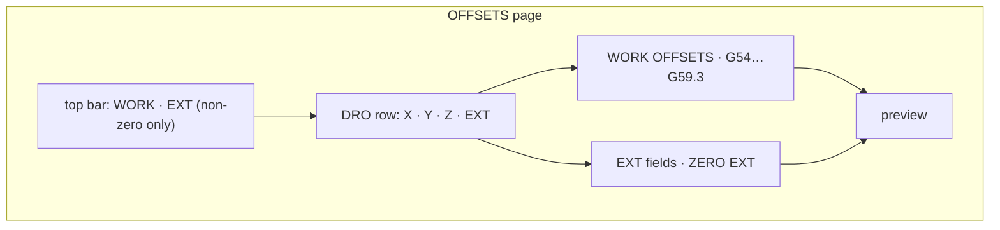
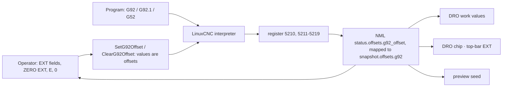
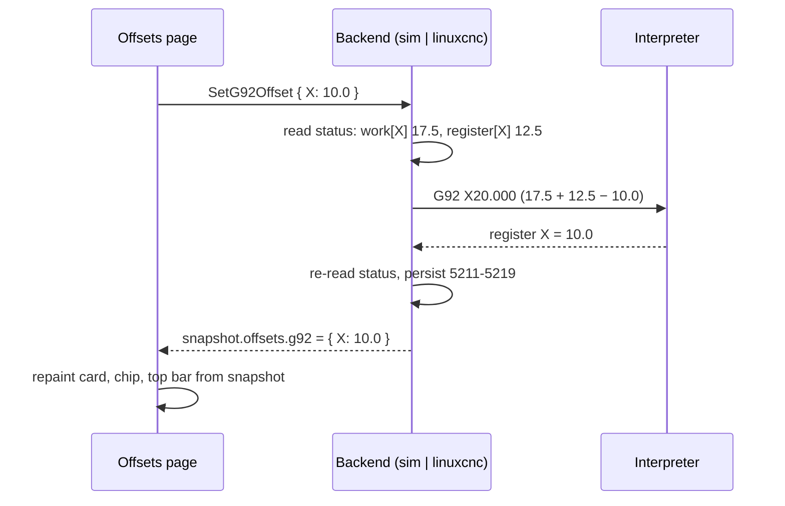
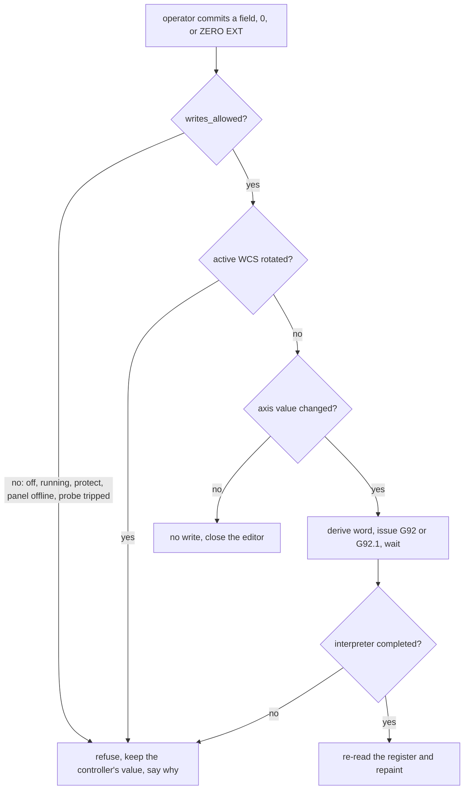
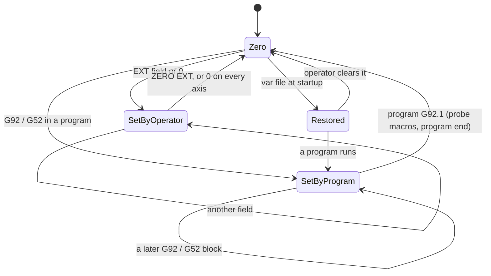

# EXT Offset (G92) - Plan

## Goal Capsule

- **Objective:** An operator can see, set and clear the global shift that moves every work offset at once, from the panel, and no page can hide a shift that is in effect.
- **Means:** an editable EXT card in the Offsets DRO row writing through an offset-valued `SetG92Offset` (KTD1).
- **Product authority:** The machine owner, acting as the operator of the machine this HMI drives.
- **Execution:** one pull request, landing in dependency order: U2 can run in parallel with U1; U3, U4, U5 and U6 follow the chain.
- **Stop conditions:** stop and report if the register cannot be read back reliably after a write, or if the unit conversion cannot be made correct on an imperial machine. Do not ship a write path that has only been reasoned about.
- **Open blockers:** None.
- **Product Contract:** clarified, no scope change. R3, R11 and R14 say the same behaviour in more exact words; R19 adds a refusal that the original scope assumed away, because the write cannot be derived safely on a rotated work system.

---

## Product Contract

### Summary

The Offsets page gains an EXT card in its DRO row, editable as offset values, with a ZERO EXT action and per-axis clear by typing 0. A non-zero shift announces itself on every DRO row and in the top bar, and a probe is refused while one is set.

### Problem Frame

LinuxCNC has a register that shifts every work offset at once: `G92`, whose values are the same ones `G52` writes. Industry controllers put that shift on the work-offset page as EXT, above G54, and the operator reads it there before running anything.

LiNC has none of that surface. The register still moves the machine: a program that sets it, a probe macro that cancels it, and a value restored from the last session all change where the part gets cut. What the operator sees is a DRO that agrees with the controller and a drawing that agrees with the controller, so a wrong shift looks exactly like a right one. `SPEC.md` §6.3 made that omission a rule, on the grounds that a field would let the operator leave the machine in a state neither the DRO nor a program could explain. Hiding the value produced the same unexplained state without the field.

The backend work for this feature is already in place and unreachable from the screen: `MachineCommand::SetG92Offset` exists with a simulator implementation and a LinuxCNC implementation that issues `G92`, waits, and mirrors the register into the parameter file.

### Key Decisions

- **EXT is a card in the Offsets DRO row, not a tenth table row.** A shift that moves every number on the page belongs beside the numbers, not inside the list of systems it moves. (session-settled: user-directed — chosen over a tenth row and a separate band above the table: the operator must not be able to read the DRO row and miss the shift.) Governs R1, R2.
- **The field is the offset value, and LiNC's backend derives the coordinate.** The typed number is what the operator means by EXT, so LiNC derives the coordinate the interpreter needs from the position the controller reports, and the controller owns the register afterwards. (session-settled: user-directed — chosen over a read-only value with touch-off actions and over literal position assignment: it is how the reference controllers behave.) Governs R3, R7.
- **No touch-off action in v1; typing 0 clears one axis.** One editor covers both "shift by this much" and "stop shifting this axis". (session-settled: user-directed — chosen over per-axis and all-axes touch-off: the smallest surface that covers the shift.) Governs R4, R5.
- **The machine INI governs persistence and LiNC never writes `G92` at startup.** A restored shift is shown from the first frame instead of being cleared or prompted for. (session-settled: user-directed — chosen over clearing after homing, a startup dialog, and forcing `DISABLE_G92_PERSISTENCE` in the profiles: no write the operator did not ask for.) Machines that want Fanuc-style clearing set `DISABLE_G92_PERSISTENCE = 1`.
- **A non-zero shift is announced on every DRO row and in the top bar.** (session-settled: user-directed — both, rather than either alone.) Governs R11, R12.
- **A probe is refused while EXT is set.** The probe subroutines cancel the register as they start, so running one with a shift in effect destroys it silently. (session-settled: user-directed — chosen over documenting it, a dialog line, and restoring the shift afterwards: nothing should clear it without the operator deciding to.) Governs R13.
- **`E` edits the card and `0` zeroes it.** (session-settled: user-directed — chosen over pointer-only and over edit-without-zero: it matches how the page already keys its editors.) Governs R14.
- **`G52` joins the preview.** One register serves both, so the drawing must implement both or it disagrees with the machine. (session-settled: user-directed — chosen over labelling the register only and over refusing programs that use `G52`.) Governs R16.

### Requirements

**The EXT surface**

- R1. The Offsets page DRO row carries a fourth card named `EXT` and marked `G92 / G52`, beside the axis readouts, showing the shift the controller reports for every axis the machine has.
- R2. Selecting the card opens a per-axis field for each of those axes, filled from the controller, with a `ZERO EXT` action.
- R3. A field holds the offset value: entering 12.5 in X sets the X shift to 12.5, and nothing moves physically.
- R4. `ZERO EXT` clears the whole register with `G92.1`, every axis at once.
- R5. Entering 0 in one field clears that axis only.
- R6. The card never writes a `G54`–`G59.3` row, a rotation, or a tool length.

**Values and the write path**

- R7. LiNC writes only through the controller. For the edited axes it issues `G92` with the coordinate derived from the position and register the controller reports, waits for the interpreter, then repaints from the value the controller reports; the typed number is never displayed as fact.
- R8. A write is refused while a program runs, while program protect is on, and while the panel is offline, on the same gate as the work-offset writes.
- R9. On a lathe the X field reads and accepts a diameter, matching the DRO, and the `G92` word carries the radius equivalent.
- R10. A refused or unanswered write leaves the card showing the controller's value and states the reason in the messages strip.
- R19. A write is refused while the active work system carries a non-zero `G10 L2 Pn R-` rotation, and the refusal names the rotation. The register cannot be derived per axis in a rotated frame from the values LiNC reads.

**Visibility outside the page**

- R11. While the register is non-zero, every axis card that draws a work coordinate carries an `EXT` chip: the Machine axis cards, the Offsets DRO row, the Probe view readout, and the Manual and Homing live rows. The Program page draws no axis card, so the top-bar metric is its announcement.
- R12. The top bar carries an `EXT` metric beside `WORK` while the register is non-zero, listing the shifted axes.

**Safety**

- R13. A probe is refused while the register is non-zero, and the refusal names the value and where to clear it.

**Keys**

- R14. On the Offsets page, `E` opens the EXT editor on the first axis and `X`/`Y`/`Z` move it to that axis's field; the arrows and Home/End stay with the text caret; `Enter` commits; `Esc` discards the draft and closes the editor when nothing has been committed, and only closes it after a commit. A bare `0` zeroes every axis. All three bindings are page-local to Offsets.

**Preview parity**

- R15. The toolpath preview starts from the live EXT shift and lets a program's `G92` or `G52` replace the register, so the drawn part sits where it will be cut.
- R16. A `G52` block assigns the register directly (`g52.insert(axis, value)` in the block walk, verified against `rs274 -g`), so a program's local offset draws where it cuts.

**Prose**

- R17. `SPEC.md` §6.3 stops excluding G92 and states this behaviour, and the page-local key table gains the two Offsets bindings.
- R18. New prose does not repeat the persistence sentence shipped in the G-code help text for parameters 5211–5219, which is inverted relative to the LinuxCNC chapter.

#### Offsets page composition

#### Where the register comes from and goes

### Key Flows

- F1. Setting the shift by typing
  - **Trigger:** the machine is on and idle, and the operator types a number into a field.
  - **Steps:** the value is parsed with the page's arithmetic; LiNC derives the `G92` coordinate from the displayed position and the register in effect; the command is issued and the interpreter waited for.
  - **Outcome:** the DRO moves by the difference, nothing moves physically, and the card shows the register the controller reports.
  - **Covers:** R3, R7, R8, R10, R19.
- F2. Clearing the shift
  - **Trigger:** a bare `0`, or the `ZERO EXT` action.
  - **Steps:** `0` and `ZERO EXT` are the same action and issue `G92.1`; `0` typed inside a field commits that one axis at zero instead.
  - **Outcome:** at zero the chip and the top-bar metric disappear; the DRO reads machine minus WCS.
  - **Covers:** R4, R5, R11, R12, R14.
- F3. Probe refused
  - **Trigger:** RUN PROBE while the register is non-zero.
  - **Steps:** the refusal happens before anything is sent to the interpreter.
  - **Outcome:** nothing runs, the shift is unchanged, and the message says what to clear.
  - **Covers:** R13.

### Acceptance Examples

- AE1. Lathe X in diameter mode
  - **Covers:** R9.
  - **Given:** the lathe shows X 100.000 as a diameter, the register is zero.
  - **When:** the operator types 100 into the EXT X field.
  - **Then:** the X readout falls to 0.000, and the register holds the radius 50.
- AE2. A program replaces the shift
  - **Covers:** R3, R15.
  - **Given:** EXT X 12.5000, and a program whose first block is `G92 X0`.
  - **When:** the program runs.
  - **Then:** the card shows the program's value, not 12.5, and the preview draws the program's frame.
- AE3. A program offsets locally
  - **Covers:** R16.
  - **Given:** the register is zero, and a program contains `G52 X1`.
  - **When:** the preview is drawn.
  - **Then:** the path is drawn one unit over while the card, chip and top-bar metric still show the controller's zero. After the program runs, the card reads 1.0000.
- AE4. A write while a program runs
  - **Covers:** R8.
  - **Given:** a program is running.
  - **When:** the operator presses Enter in an EXT field, or `0`.
  - **Then:** no `G92` is issued and the card keeps the controller's value.
- AE5. Shift restored from the last session
  - **Covers:** R11, R12.
  - **Given:** the controller reports a non-zero register after startup and the machine homes.
  - **When:** the page comes up.
  - **Then:** the chip and the top-bar metric show it from the first frame, and LiNC issues no `G92`.
- AE6. The neighbouring rows are untouched
  - **Covers:** R6.
  - **Given:** any EXT edit.
  - **When:** the write completes.
  - **Then:** every `G54`–`G59.3` value and rotation is unchanged.
- AE7. A rotated work system
  - **Covers:** R19.
  - **Given:** the active work system carries a non-zero rotation.
  - **When:** the operator commits an EXT field.
  - **Then:** nothing is sent, and the message strip names the rotation that blocks the write.

### Scope Boundaries

- **Deferred for later:** `G92.2` suspend and `G92.3` restore; a per-axis touch-off ("this point is EXT zero"); editing EXT from pages other than Offsets; any automatic clearing at startup; correcting the shipped G-code help text for parameters 5211–5219; guidance in the profiles about `DISABLE_G92_PERSISTENCE`.
- **Considered and not built:** a message when a running program clears the register with its own `G92.1`. The chip and the top-bar metric vanish and the DRO jumps by the shift from the same snapshot, so the change is already visible, and refusing such programs would refuse every probe macro.
- **Considered and not built:** distinguishing a suspended register (`G92.2`) from an applied one. The card would show stored values that no shift is using, and a probe would stay refused until they are cleared. Detecting the suspended case needs a status field LiNC does not read today, and the fail-closed refusal costs one keystroke to satisfy.
- **Not this feature's problem:** the probe bundle's decision to cancel the register, and any behaviour of `G52` inside a running program beyond what the preview draws.

### Dependencies / Assumptions

- `G92` semantics as documented in the LinuxCNC coordinate chapter: applied after the work offset and after `G10 R-` rotation, register shared with `G52`, restored across restart by default, and cleared from the var file only under `DISABLE_G92_PERSISTENCE = 1`.
- The interpreter derives a new register from the position **without** the register in effect: `G92 X5` then `G92 X10`, with no motion between, sets the register to −10 rather than −5. Verified with `rs274 -g`.
- The register LiNC reads is the value the interpreter holds, and the work position it reports already has the register and the tool length removed. So `work + register − wanted` is the whole derivation, in the frame the controller reports.
- Backend support exists and has no UI caller: `SetG92Offset` in `crates/linc-core/src/command.rs`, with implementations in the simulator and in the LinuxCNC backend, plus the parameter-file mirror at keys 5211–5219. The mirror does not touch 5210, the interpreter's "applied" flag, so what survives an unclean shutdown is the values, not the flag.
- The probe bundles LiNC runs cancel the register: 49 of the 90 subroutines under the probe bundle issue `G92.1` on their first lines.
- Program protect and the running gate already fail closed for offset writes; this feature reuses that gate rather than adding a rule.

### Sources / Research

- LinuxCNC, [Coordinate Systems](https://linuxcnc.org/docs/html/gcode/coordinates.html), sections 4 and 5: `G52`, `G92`, `G92.1`–`G92.3`, persistence cautions, and the shared-register caution.
- Interpreter probes run here, not taken from prose: `G10 L2 P0 X5` wraps into G54 rather than the register; `G10 L2 P1 X10` with `G92 X5` yields register −15; `G52 X1 Y2` yields register 1, 2; and the register-blind probe in the assumptions above, which is what fixes the derivation's shape.
- Existing plumbing: `crates/linc-core/src/command.rs`, `crates/linc-core/src/sim.rs`, `crates/linc-linuxcnc/src/lib.rs`, `crates/linc-linuxcnc/src/snapshot.rs`, `crates/linc-linuxcnc/src/parameters.rs`, `crates/linc-ui/src/shell/sync.rs`, `crates/linc-ui/src/screens/offsets.rs`, `crates/linc-core/src/gcode.rs`, `crates/linc-core/src/model.rs`.
- Current rule being reversed: `SPEC.md` §6.3 ("G92 is deliberately not exposed here").
- Keys and their conflicts: `configs/base.toml` `[keys]` (`Ctrl+E` belongs to the lathe radius/diameter toggle); the page-local table in `SPEC.md`.
- Probe bundle: `probe_basic_dev/configs/probe_basic/subroutines/`.
- Directional sketch used for the layout decision, machine-local and best effort: `/home/jack/CNC/tmp/g92-ext-probe/ext-offset-layouts.html`. Read requirements above it if the file is gone; a missing sketch blocks nothing.

---

## Planning Contract

### Key Technical Decisions

- KTD1. **The backend derives the word from the position and the register the controller reports.** `word = work + register − wanted`, where `work` and `register` come from the same status read, so an edit is absolute rather than additive and no stale UI value can shift a part. The register term is what makes a second edit land on the typed number instead of the sum. (session-settled: user-directed — inherits the Product Contract decision that the field is the offset value; chosen over the HMI computing the word.) Governs R3, R7.
- KTD2. **An edit sends only the edited axis; `G92.1` is its own command.** `G92` assigns per axis, so a block naming one axis cannot move a neighbouring axis. The clear path adds a `ClearG92Offset` command rather than routing `G92.1` through MDI, so it passes the same write gate as R8 requires. Governs R4, R5, R6.
- KTD3. **The preview is seeded through its existing entry point, not a second path.** One more parameter on the full preview call carries the live register; every caller passes the snapshot's. A parallel preview path would let the page and the drawing drift apart again. (session-settled: user-approved — the plan-time scoping synthesis named this call and the user confirmed it.) Governs R15.
- KTD4. **The chip is drawn by the shared readouts, not per page.** Two shared widgets carry it: `paint_dro_readout` for the axis cards and `live_coordinates_card` for the Manual and Homing rows, which take their content from the caller's rows. (session-settled: user-approved — named in the same confirmed synthesis, corrected here to the two widgets the code actually has.) Governs R11.
- KTD5. **The command speaks machine units; the diameter conversion lives in the page.** `CODING_STANDARDS.md` already requires offset writes in absolute machine units, so one conversion point on the screen keeps the write path unit-free and testable. Governs R9.
- KTD6. **The register is read back after the write, never assumed.** The card, the chip and the top-bar metric all read the snapshot; nothing in the HMI caches a typed value. Governs R7, R10.
- KTD7. **`G52` and `G92` are implemented as one register in the block walk.** Two registers would draw a program's local offset in the wrong frame and make the card report a number the drawing does not use. Governs R16.
- KTD8. **A rotated work system is refused instead of approximated.** LiNC's snapshot does not apply the XY rotation, so the register cannot be derived per axis in a rotated frame from what it reads; refusing keeps a wrong-axis cut from landing silently. Governs R19.

### High-Level Technical Design

`SetG92Offset` keeps its name and changes meaning: `values` are the offsets the operator asked for, not coordinates. `ClearG92Offset` is new and issues `G92.1` through the same gate.

Every write passes the same gate chain before anything reaches the interpreter.

The register has four reachable states in this plan; the two suspended states exist in the interpreter and stay out of scope.

### Assumptions

- Modal units (G20/G21) are whatever the interpreter last set, so the derived word is converted the same way the existing work-offset write converts `G10` values.
- The `G92` write completes inside the backend's existing two-second wait on this machine.
- The register the NML status reports is in the same frame as the work position it reports, so the two can be added without applying the rotation. R19 is the guard for the case where that assumption would matter.
- A `G52` block assigns the register absolutely for the axes it names; unnamed axes keep their previous value. Verified with `rs274 -g`.

### System-Wide Impact

- Six screens change what they draw: three through `paint_dro_readout`, two through `live_coordinates_card`, and the top bar on all of them.
- Every page that draws a preview can now draw a different frame, because the seed is live. A program's own `G92`/`G52` still wins.
- The `[keys]` table gains two entries, which `--check-config` validates against the key parser.
- The command enum gains a variant, and both backends change together.
- The probe page gains a refusal path that names an offset, which is the first time a probe can be blocked by machine state outside the probe itself.

### Risks & Dependencies

- **A compounding edit.** If the derivation drops the register term, the second edit adds to the first: the operator types 12.5 twice and the shift becomes 25. Two of the corrections to this plan were that exact defect, so the idempotence case is a required test, not a nice one.
- **Sign or offset error in the derivation.** A wrong sign shifts every part by twice the mistake and nothing looks broken. The unit is proven with a direction test.
- **Display units leaking into the write** on a lathe, which the coding standards call out as a known defect class. KTD5 puts the conversion on one side of the boundary and a test pins it.
- **Imperial machines.** The interpreter reads the `G92` word in its current modal units; a machine in G20 would land the shift off by 25.4.
- **The probe bundle clears the register.** R13 refuses the run rather than allowing a silent clear; the bundle itself is not modified.
- **The preview seed changes five screens at once.** A visual check across pages is part of verification, because no test asserts what the operator sees.
- **`SetG92Offset` has no caller today,** which is what makes the contract change cheap. Confirm that with a search before changing it; if a caller appeared, the change needs a compatibility decision instead of a rename.

---

## Implementation Units

### U1. Offset-valued write path and the clear command

- **Goal:** `SetG92Offset` carries offset values in every implementation, `ClearG92Offset` carries the all-axis clear, both derive nothing in the HMI, and neither lets a stale value reach the machine.
- **Requirements:** R3, R4, R7, R8, R10, R19; KTD1, KTD2, KTD6, KTD8.
- **Dependencies:** none.
- **Files:**
  - `crates/linc-core/src/command.rs` — the offset meaning on `SetG92Offset`, the new `ClearG92Offset`, and both labels in `describe`.
  - `crates/linc-core/src/sim.rs` — both arms plus its inline `#[cfg(test)] mod tests`.
  - `crates/linc-linuxcnc/src/lib.rs` — the derivation helper, both arms, the rotation refusal, and the existing inline tests.
  - `crates/linc-linuxcnc/src/snapshot.rs` — only if the rotation guard needs a field the snapshot does not already carry.
- **Approach:**
  - The simulator sets the register to the wanted values and shifts each axis's displayed work position by `old − new`, so the DRO moves by the difference and the machine coordinates do not.
  - The LinuxCNC arm derives `work + register − wanted` from one status read, formats one word per named axis in the interpreter's current units, issues `G92`, waits, re-reads, mirrors the register into the parameter file, and returns.
  - The clear arm issues `G92.1` and takes the same gate.
  - The rotation refusal reads the active work system's rotation from the same snapshot the page uses.
- **Patterns to follow:** `write_work_offset` in `crates/linc-linuxcnc/src/lib.rs` for the unit conversion and the wait; the `SetWorkOffset` arm in `crates/linc-core/src/sim.rs` for the position shift.
- **Test scenarios:**
  - Simulator: from work X 0 with the register at zero, an offset of 12.5 sets the register to 12.5 and the work readout to −12.5.
  - Simulator: with the register at 12.5, typing 12.5 again leaves the register at 12.5 and the readout unchanged, which is the idempotence the derivation's register term buys.
  - Simulator: typing 0 with the register at 12.5 leaves the register at 0 and the readout back to machine minus WCS.
  - Simulator: editing one axis leaves every other axis's register value and readout untouched (`Covers AE6`).
  - Simulator: a write while a program runs returns the not-idle error and leaves the register as it was (`Covers AE4`).
  - Simulator: `ClearG92Offset` zeroes every axis at once (`Covers R4`).
  - Backend helper: work 17.5 with the register at 12.5 and a wanted offset of 10.0 produces a word of 20.0, pinning both the direction and the register term.
  - Backend helper: an intended offset equal to zero at work 17.5 with the register at 12.5 produces a word of 30.0.
  - Backend helper: an imperial profile converts the word from machine units to inches.
  - Backend: after a successful write the persisted parameter file carries the register the controller reported, not the value that was sent.
  - Backend: a write on a rotated work system is refused, with the rotation named (`Covers AE7`).
- **Verification:** the simulator's register and readout move together, and typing the same number twice is a no-op on the second commit; a live LinuxCNC session shows the operator-typed number in the card after one write, with no second write needed.

### U2. Preview seeded from the live register, with `G52`

- **Goal:** the drawn path starts from the register the machine holds, and a program's `G92` or `G52` replaces it, so the drawing agrees with the cut.
- **Requirements:** R15, R16; KTD3, KTD7.
- **Dependencies:** none; it can land in parallel with U1.
- **Files:**
  - `crates/linc-core/src/gcode.rs` — the seed parameter on the full preview call, `G52` in the block walk, and the inline tests.
  - `crates/linc-core/src/sim.rs`, `crates/linc-core/src/cycletime.rs`, `crates/linc-core/src/probe.rs` — the other callers of the preview entry point, and the `parse_preview` / `parse_preview_with` wrappers.
  - `crates/linc-ui/src/shell/mod.rs`, `crates/linc-ui/src/shell/view.rs`, `crates/linc-ui/src/shell/program.rs`, `crates/linc-ui/src/screens/mdi.rs`, `crates/linc-ui/src/state.rs` — callers pass the snapshot register.
  - `crates/linc-view/src/lib.rs` — its test callers.
- **Approach:**
  - The register starts from the seed instead of an empty map; a `G92` or `G52` block then overwrites it exactly as the interpreter does.
  - `G52` assigns the named axes directly, with no derivation from the current position, which is the one line where the two commands differ.
  - The seed reaches the preview from the same snapshot the DRO uses, so the trail shift and the program path keep their existing relationship.
- **Patterns to follow:** the existing `g92` handling in the block walk, including `frame_of`, `g92_set`, and the suspend/restore trio.
- **Test scenarios:**
  - A program that never mentions `G92` draws shifted by a non-zero seed.
  - A program whose first block is `G92 X0` draws in the program's frame, not the seeded one (`Covers AE2`).
  - `G52 X1` shifts the drawn path by one unit and leaves the other axes alone (`Covers AE3`).
  - `G52 X1` followed by `G92.1` returns the path to the unshifted frame.
  - A seed with a non-zero Z moves the path in Z without touching X or Y.
  - A seed plus a program `G52` on the same axis ends at the program's value.
- **Verification:** the Offsets preview and the Program page draw the same part position for the same register; a manual check with `G52` in a real program shows the path landing where the machine cuts.

### U3. EXT card and per-axis band on the Offsets page

- **Goal:** the operator sees the register beside the axis readouts, edits it as offset values, and clears one axis or all of them without leaving the page.
- **Requirements:** R1, R2, R3, R4, R5, R6, R8, R9, R10, R14, R19; KTD2, KTD5, KTD8.
- **Dependencies:** U1, U2.
- **Files:**
  - `crates/linc-ui/src/screens/offsets.rs` — the card, the band, the page-local keys, and a new inline test module.
  - `crates/linc-ui/src/state.rs` — the EXT editor state, replacing the dead `g92: Vec<String>` with the axis-keyed draft the band edits.
  - `crates/linc-ui/src/shell/sync.rs` — stop padding the string vector; keep populating whatever the band reads.
  - `crates/linc-ui/src/shell/keyboard.rs` — add the band's field id to the text-focused list.
  - `crates/linc-ui/src/shell/hints.rs` — the two Offsets shortcut rows.
  - `crates/linc-core/src/config.rs` and `configs/base.toml` — the two `[keys]` defaults.
  - `CONFIGURATION.md` — the `[keys]` table rows.
- **Approach:**
  - The card sits last in the DRO row and takes a fixed width measured from the axis count and the `G92 / G52` mark; that width comes off the row before the axis cards divide the remainder, so an axis card keeps its width. The mark drops whole before any value does.
  - The card takes the page's accent frame while its band is open, the way the DRO cards mark the axis being edited.
  - Committing a field converts the displayed value to machine units (diameter on a lathe, per KTD5), sends only that axis, and keeps the editor open on the value the controller reports back.
  - A bare `0` and `ZERO EXT` are the same action; `0` typed inside a field commits that axis at zero. `Esc` discards an uncommitted draft and only closes the band after a commit.
  - The band's keys are consumed only when the page is in front, no overlay is open, no text editor holds focus outside the band, and the EXT editor is the active one; the band consumes `X`/`Y`/`Z` before the page's DRO keys see them.
  - The Offsets shortcut pane gains `E EXT` and `0 ZERO EXT` rows, the second dispatching the same clear path the key does.
- **Execution note:** write the key-routing tests first; the page-local key bugs in this repo come from guards that fire before the page and focus are tested.
- **Patterns to follow:** the work DRO's in-place editor in the same file, the tool table's cell editor, `common::focus_anchor` for the page's starting focus, and the `A ACTIVATE` shortcut row in `hints.rs`.
- **Test scenarios:**
  - `E` opens the band on the first axis and puts the focus ring in that field; `X`, `Y` and `Z` move the focus to that axis's field.
  - The arrows and Home/End stay inside the field and move the caret, matching the page's other editors.
  - `Escape` before any commit discards the draft, closes the band and sends nothing.
  - `Escape` after a commit only closes the band and sends no second command.
  - Typing 0 in one field sends that axis alone and leaves the other axes' entries in place.
  - A bare `0` on the page sends the clear command and the card reads zero afterwards.
  - A lathe profile converts a typed diameter to the radius the command carries, and the readout falls by the typed amount (`Covers AE1`).
  - A write attempt while a program runs leaves the draft open and the card showing the controller's value (`Covers AE4`).
  - A write attempt on a rotated work system is refused before anything is sent (`Covers AE7`).
  - With three axes and with four, the axis cards keep their width once the EXT card is in the row, and every value stays inside its card at the minimum window width.
  - `E` and `0` are not consumed while a dialog is open, while the page is not in front, or while the G-code editor holds focus.
  - Opening the band does not move the work table's selection, and `A` still activates the table's row while the band is closed.
- **Verification:** on the sim profile, the card's value survives a page change and a page restart, and matches the parameter file after the write.

### U4. `EXT` chip on every DRO and the top-bar metric

- **Goal:** no page shows a shifted number without saying that a shift is in effect.
- **Requirements:** R11, R12; KTD4.
- **Dependencies:** U1 (the register must be trustworthy before it is announced).
- **Files:**
  - `crates/linc-ui/src/screens/common.rs` — the chip inside `paint_dro_readout`, the extra slot on `LiveAxisRow` for `live_coordinates_card`, both width budgets, and the inline tests.
  - `crates/linc-ui/src/screens/manual.rs`, `crates/linc-ui/src/screens/homing.rs` — set the new row slot; the Homing status badge keeps its own.
  - `crates/linc-ui/src/screens/probe_view.rs` — its readout call site.
  - `crates/linc-ui/src/shell/chrome.rs` — the `EXT` metric beside `WORK`.
  - `crates/linc-ui/src/shell/status.rs` — the formatter both surfaces read.
  - `crates/linc-ui/src/shell/ui_tests.rs` — the text assertions for both surfaces.
- **Approach:**
  - The chip is one short word on every axis card of a row while the register is non-zero, not only on the shifted axes, so the row cannot imply that some axes moved and others did not.
  - Within one card, the dimmed machine coordinate drops before the chip does; the chip itself drops only when it would touch the value at the card's minimum width.
  - The Manual and Homing rows carry it in their own slot beside the status badge, because Homing's badge holds the homing state.
  - The top-bar metric lists the shifted axes only, in axis order, three decimals, and degrades to `EXT` alone rather than clipping when the bar runs out of room.
- **Patterns to follow:** `machine_status_field` and `network_metric` for conditional fields; `dro_line_layout` for the readout's own width decisions.
- **Test scenarios:**
  - A non-zero register puts `EXT` on the Machine, Offsets, Probe view, Manual and Homing rows (`Covers AE5`).
  - A zero register puts it on none of them.
  - A narrow card drops the machine coordinate first and the chip second, and never overlaps a value.
  - On the Homing page the chip and the homing status badge both show, each in its own slot.
  - The top-bar metric reads `+12.500` and `-3.250` for a two-axis shift, and lists three axes at 1280 without clipping.
  - A machine with no register populated shows neither surface.
- **Verification:** a screenshot pass over the six surfaces at 1280×720 shows the chip inside every card's bounds with no value moved.

### U5. Probe refused while the shift is set

- **Goal:** a probe run cannot silently destroy the operator's shift.
- **Requirements:** R13.
- **Dependencies:** U1 (the register read), U4 (the announcement tells the operator where to look).
- **Files:**
  - `crates/linc-ui/src/screens/probe.rs` — the refusal at the run gate, plus its inline tests.
  - `crates/linc-ui/src/shell/gates.rs` — only if the refusal belongs with the shared gates.
- **Approach:**
  - The gate runs before any command is sent and reuses the page's existing refusal presentation, so a blocked run looks like every other blocked run.
  - The message names the axes that hold a shift and the page that clears it.
- **Patterns to follow:** the existing `writes_allowed` refusals on the probe page (two of them already sit at its run and apply paths).
- **Test scenarios:**
  - RUN PROBE with a non-zero register is refused and no command is dispatched.
  - The refusal names the shifted axes and points at the Offsets page.
  - With the register at zero the same run is allowed.
  - The refusal does not alter the register.
- **Verification:** in the sim, pressing RUN PROBE with EXT set shows the refusal and leaves the parameter file untouched.

### U6. Prose

- **Goal:** the documents stop forbidding the feature and describe what it now does.
- **Requirements:** R17, R18.
- **Dependencies:** U1–U5 (the behaviour must be settled before it is written down).
- **Files:**
  - `SPEC.md` §6.3 — replace the "deliberately not exposed" rule with the card, the chip, the top-bar metric, and the probe and rotation refusals.
  - `SPEC.md` page-local key table — the two Offsets bindings.
  - `AGENTS.md` — the UI conventions entry for the band's editor id, if the band introduces one.
- **Approach:** state the register as one shared by `G52`, and describe the field as an offset value. Do not repeat the shipped help text's persistence sentence (R18).
- **Test expectation: none — documentation only; `cargo test --workspace` still runs to catch a rewritten test name or a broken intra-doc link.

---

## Verification Contract

| Check | Command | Applies to | Done signal |
| --- | --- | --- | --- |
| Workspace tests | `cargo test --workspace` | every unit | passes, including the new simulator, preview, page and gate tests |
| Formatting | `cargo fmt --all -- --check` | every unit | clean |
| Profile validation | `./target/release/linc --config configs/sim.toml --check-config` | U3 | exits zero with the two new `[keys]` entries |
| Lathe profile validation | `./target/release/linc --config configs/lathe-sim.toml --check-config` | U3 | exits zero; proves the diameter path's profile still loads |
| Live exercise | `./scripts/start-sim.sh --detach --release-estop --power-on --home` | U1–U5 | one typed offset appears as the controller's value; the same number typed again changes nothing; chip and top-bar metric appear and vanish; a probe is refused; a `G52` program draws shifted |

- Release binaries only: the scripts run `target/release`, so build with `cargo build --release` before the live exercise.
- The interpreter probes that ground the arithmetic (`rs274 -g` on a small program) run one at a time; two at once crash.
- The Markdown plan stays the record; no test asserts what the operator sees, so the screenshot pass in U4 is manual evidence.

## Definition of Done

- Every unit is complete, in dependency order, in one pull request.
- The Product Contract still reads as written: no requirement weakened, no acceptance example quietly dropped.
- Typing the same offset twice leaves the register at that offset, proven by a test on both the simulator and the backend helper.
- One formatter feeds the card, the chip and the top-bar metric; no second copy of the register text.
- The dead `g92` string vector is gone, and nothing left behind from an abandoned approach remains in the diff.
- The derivation has a direction test that runs through the interpreter, and the lathe conversion has one that would fail on a factor-of-two error.
- `SPEC.md`, the page-local key table and `CONFIGURATION.md` describe what the code does.
- `cargo test --workspace` and `cargo fmt --all -- --check` pass; both `--check-config` profiles exit zero.
- The live exercise in the Verification Contract has been run, not just planned.
